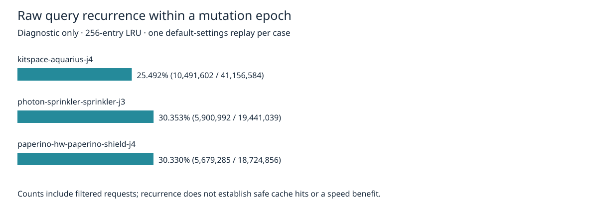

# Bounded query recurrence census

Diagnostic measurement only. Production, tests, physical rules and routing decisions remain unchanged. This package instruments an isolated source snapshot to determine whether repeated lattice query geometry warrants a future cache experiment. It does not implement caching or claim a speed improvement.

On hyper-ms-lin, cores 12–19, nice 10, one sequential default-settings seed-1 replay per case (100 maximum passes, optimizer enabled, local recovery unset), a 256-entry per-lattice LRU observed:

| Case | Raw requests | Repeated geometry | Recurrence | Retained → diagnostic engine incomplete | Retained → diagnostic represented violations added |
|---|---:|---:|---:|---:|---:|
| kitspace-aquarius-j4 | 41,156,584 | 10,491,602 | 25.492% | 8 → 8 | 0 → 0 |
| photon-sprinkler-sprinkler-j3 | 19,441,039 | 5,900,992 | 30.353% | 2 → 2 | 0 → 0 |
| paperino-hw-paperino-shield-j4 | 18,724,856 | 5,679,285 | 30.330% | 6 → 6 | 0 → 0 |

All three sessions are byte-identical to the retained default-setting native exports in the adjacent `default-slow-profile` package. Full settings/results/statistics/diagnostics match after removing only `report.wallClockMs`. These incomplete/violation values are **engine reports, not native scores**. No native checker/full 26×3/dense/ladder/slow-acceptance run was completed here. Existing native thermal errors, opens and adverse L3 tail remain unresolved. Recovery stays disabled by default.

Instrumentation durations were 67.278542, 25.141562 and 24.859956 seconds respectively; they include substantial string-key/counter overhead and are excluded from speed comparisons. The previous package's direct unprofiled durations are historical single attempts, not paired controls. No before/after runtime claim is warranted.



Key: sheet, sweep-versus-box mode, four axis bounds and (for sweeps only) four diagonal bounds. Each lattice retains at most 256 keys and an immediately preceding key; all are cleared before slot allocation/release or explicit rebuild. The wrapper calls the original collector on **every** request and returns its original array. It never reuses or modifies query results. All five lattices per process contribute counters, including queries when a sheet is absent. Counts include exact geometry recurrence with filters; filter identities and mutable predicate state are deliberately not part of the geometric key. Thus these are potential repeated raw index queries, **not validated cache hits**. Result-array ownership, filter callback ordering/state, index/directory invalidation and bounded cache overhead must be established before any production cache.

`filteredHits` was 480/1082/798; most repeated geometry was requested without filters. `consecutive` was only 107995/66390/32453, so a single immediately preceding query cache would capture much less than the 256-entry window. Evictions were 30.57M/13.47M/13.00M; retain these costs when designing an alternative key representation. Do not infer saved elapsed time from hit counts.

The base source archive, complete immutable source hashes, inputs, licenses, provenance and reference sessions are retained in adjacent `default-slow-profile`. Its engine src/spec bytes match the starting cycle88 HEAD d99300a6. `instrumented-grid.ts.gz` is the only changed source file; `source-audit.json.gz` hashes the complete instrumented src/spec tree. Engine license notices are retained alongside the referenced archive. New evidence adds no board redistribution beyond those licensed inputs.

Reproduce from repository root with installed Bun (new directory only):

```bash
ASSET="$PWD/docs/pr-assets/agent-fab-router-perf-local-rescue/query-census"
python3 "$ASSET/reproduce.py" /tmp/query-census-new-run
PYTHONDONTWRITEBYTECODE=1 python3 "$ASSET/verify.py"
PYTHONDONTWRITEBYTECODE=1 python3 "$ASSET/test-verify.py"
bun "$ASSET/test-census.ts"
python3 "$ASSET/plot.py"
taskset -c 12-19 nice -n 10 timeout --kill-after=10 1800 bash -c 'bun run typecheck && bun run check:layers && bun run test'
```

The runner verifies all base source hashes before instrumentation and all instrumented hashes before routing. Each process has a 180-second timeout plus five-second kill grace. `runs/` retains each complete summary, session, instrumented timing and raw counter log. `summary.json` is independently regenerated by `verify.py`; four deliberate session/report/source/missing-counter corruptions are rejected. The exact injected wrapper passes synthetic result-identity, mutation reset, sheet/mode/diagonal key, filter counting and LRU eviction checks.

Next experiment: bounded raw collector caching with exact key comparison, conservative mutation invalidation, filter evaluation on every request, detached result arrays, differential stateful tests and alternating direct replays. Adoption requires unchanged sessions/full reports, required tests and full 26×3 native gate; this census alone satisfies none of those adoption gates.

Final repository validation: typecheck PASS; 71 layer files / zero violations; 914 tests / zero failures / 649747 assertions. See `checks.log.gz` for the complete run.
