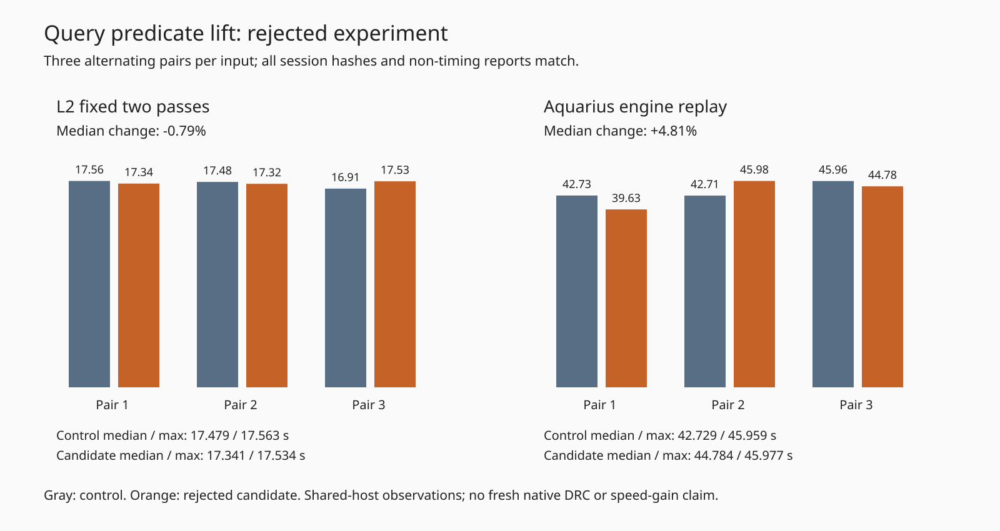

# Rejected query-predicate lift

The experiment moves the lattice overlap predicate from a closure created by each `collect` call to a function created once per lattice. Query bounds and the sweep flag become explicit arguments. The comparisons, bucket traversal, stamping, filter calls, shelf, result allocation and sorting remain unchanged. This differs from the earlier rejected collector rewrite and trivial-sort experiments.

**Rejected; no engine change adopted.** L2 has a slightly lower median but higher total, and Aquarius has a higher median and maximum. The mixed shared-host observations do not justify adoption or establish a causal slowdown. The original and candidate snapshots differ only in `src/lattice/grid.ts`; `lift.py` generates the exact retained candidate and refuses unexpected input. Baseline source is immutable commit `1e65df94`; full hashes are in `source-audit.json`.

Both workloads run on `hyper-ms-lin`, Bun 1.4.0, cores 12–19, three alternating pairs in candidate/control, control/candidate, candidate/control order. Own heavy jobs run sequentially; other host work is uncontrolled. Commands request `nice -n 10`; inherited priority and the nested L2 wrapper produce observed effective nice 19 for L2 and 15 for Aquarius. Compare versions within a workload only. p95 below is the maximum of just three samples, a limited tail estimate. All attempts, including the adverse second Aquarius candidate, are retained.

| Engine replay (3 attempts/version) | Control median / p95 s | Rejected candidate median / p95 s | Control / candidate total s |
|---|---:|---:|---:|
| L2 `l2-cycle18.dsn`, fixed two passes | 17.478568 / 17.562979 | 17.341279 / 17.533535 | 51.951745 / 52.194902 |
| Aquarius, retained native-export input | 42.729378 / 45.958870 | 44.783931 / 45.977300 | 131.399207 / 130.391999 |

All six L2 sessions are byte-identical. All six fresh Aquarius session hashes match each other and the separately retained historical full-session bytes. Settings, statistics and complete reports match within each workload except `wallClockMs`. Recovery logs also match after removing only `seconds` fields recursively from parsed `local-recovery result` records; other log lines compare exactly. Raw logs are retained unchanged. The verifier rejects deliberately changed session bytes, report completion and a recovery-log net id, including when duplicate raw metadata is kept consistent.

| Quality per attempt, both versions | L2 | Aquarius |
|---|---:|---:|
| Engine-incomplete connections | 21 | 8 |
| Added represented-rule violations | 0 | 0 |
| Vias | 51 | 130 |
| Track length mm | 1094.342601 | 1731.113127 |

These are **engine replays with `localRecovery:true`**, not fresh native checks or a full-suite score. Recovery remains default off. The native thermal errors previously reported in the PR remain unresolved. No native pass/open/error improvement, full 26×3 rerun, dense/L3 result, slow-acceptance result or consumer pin update is claimed for this rejected experiment. Rejection at the focused speed gate avoids promoting an unsupported optimization.



Reproduce from the repository root, with its dependencies installed, using a new destination:

```bash
ASSET=docs/pr-assets/agent-fab-router-perf-local-rescue/query-predicate
PYTHONDONTWRITEBYTECODE=1 python3 "$ASSET/reproduce.py" "$PWD" /home/hyper/bench/agents/codex-fabpcb-perf/scratch/query-predicate-reproduce
PYTHONDONTWRITEBYTECODE=1 python3 "$ASSET/verify.py"
PYTHONDONTWRITEBYTECODE=1 python3 "$ASSET/test_verify.py"
python3 "$ASSET/plot.py"
taskset -c 12-19 nice -n 10 timeout --kill-after=10 1800 bash -c 'bun run typecheck && bun run check:layers && bun run test'
```

`reproduce.py --prepare-only` verifies complete immutable source/test/support hashes and stages both runners without routing. The original absolute-path invocation scripts are retained as `original-run.py` and `original-aquarius.py`. Exact settings are in the raw results and runner sources. L2 has a 600-second engine / 900-second process timeout per attempt; Aquarius uses its retained native-export rules and a 300-second process timeout. Neither workload timed out or aborted.

Setup/analysis issues: initial candidate typecheck omitted documentation helpers imported by existing tests; the missing files were archived without modifying measured production code, and candidate typecheck/layers then passed. A nominal correction accidentally ran root static checks; that log is retained separately. Candidate lattice property tests pass (7 tests, 39753 assertions). The original Aquarius supervisor completed all six attempts then exited 1 because its log comparator included elapsed seconds. The corrected verifier narrowly normalizes those diagnostic time fields and passes; raw reports require only the existing `wallClockMs` exception. Full final engine checks are retained in `checks.log.gz` and recorded in `validation.json`. No tests, expectations or physical rules were weakened.

Aquarius input licensing is retained in `../native-profile/input-LICENSE`; source work provenance is in `reference-provenance.json`. The L2 synthetic input is also retained in the earlier `../rim-composition/ladder-records.json.gz` package. The final manifest covers every package file except itself; all members must be tracked.
