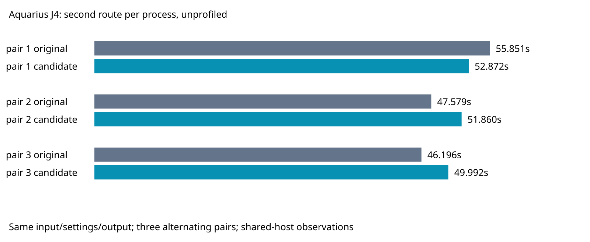

# Counterbalanced slow-case timing and profiles

Unchanged source; Aquarius J4 from the prior frozen native sweep. Three sequential unprofiled pairs on the same host, cores 12–19/nice 10: original/candidate, candidate/original, original/candidate. Each process routes twice. A separate candidate/original CPU-profile pair also routes twice and is excluded from timing aggregates. Every invocation has a 600-second timeout. No own heavy checks overlap measurements.

| Engine route metric, three observations per mode | Original | Front cache |
|---|---:|---:|
| First route median seconds | 47.705532 | 52.278645 |
| First route p95 seconds | 54.834900 | 52.849217 |
| Second route median seconds | 47.578668 | 51.860308 |
| Second route p95 seconds | 55.851230 | 52.871871 |
| Engine incomplete, every replay | 8 | 8 |
| Represented-rule violations, every replay | 0 | 0 |
| Vias, every replay | 130 | 130 |
| Track length mm, every replay | 1731.113127 | 1731.113127 |

Nearest-rank p95 is the maximum of three. Warmed median regresses 9.00%; p95 improves 5.33%. The first pair favors the candidate; the next two favor the original. Shared-host variation and these small samples do not establish causality or universal gain. Read this alongside both prior full-suite sweeps: this evidence weakens a consistent cache speedup claim. No engine change is adopted here.

All sixteen session hashes, settings, final statistics, input hashes and reports excluding wallClockMs match. No timeout/abort. The common session hash also matches the cycle78 native candidate session for this exact input (not a fresh native run). Source audit covers 1,549 files per snapshot against original d62ccee9 and candidate 790256b1 (full revisions in source-audit.json). Paths in profiles resolve through the existing cycle78 symlinks to the audited cycle77 snapshots. Engine statistics are not fresh native scoring; prior full-native thermal failures remain unresolved.

Profile self samples across two routes: pointInRing 25.106/26.198 seconds (original/candidate), collect 12.327/12.713, its test callback 7.215/7.589, quilt state 3.245/3.007. Sampled wall time includes overhead and is not a causal speed comparison. Polygon containment and lattice collection are larger future profiling targets than quilt lookup. Raw profiles and top-25 summaries are retained.



## Reproduce

Prerequisites: Bun 1.4.0, Python 3, repository dependencies, and a disposable directory under ~/bench. From this repository, prepare the measured revisions and archived input:

```sh
p="$PWD/docs/pr-assets/agent-fab-router-perf-local-rescue/quilt-counterbalanced"
s="$HOME/bench/agents/codex-fabpcb-perf/scratch/cycle79-repro"
mkdir -p "$s/original" "$s/candidate" "$s/input"
git archive d62ccee9 src spec tools package.json tsconfig.json | tar -x -C "$s/original"
git archive 790256b1 src spec tools package.json tsconfig.json | tar -x -C "$s/candidate"
for f in board.dsn candidate-settings.json dsn-manifest.json; do gzip -dc "$p/$f.gz" > "$s/input/$f"; done
for order in 'original candidate' 'candidate original' 'original candidate'; do
  for mode in $order; do
    taskset -c 12-19 nice -n 10 timeout --kill-after=5 600 bun "$p/replay.ts" "$s/$mode" "$s/input" 2
  done
done
for mode in candidate original; do
  taskset -c 12-19 nice -n 10 timeout --kill-after=5 600 bun --cpu-prof --cpu-prof-dir "$s" --cpu-prof-name "$mode.cpuprofile" "$p/replay.ts" "$s/$mode" "$s/input" 2
done
```

Raw run.py retains the actual invocation paths/order; replay.ts explicitly enables localRecovery and preserves native settings. The initial failed attempt routed once but could not emit a record because source-hash paths pointed inside the adapter wrapper; its stderr/log are retained and excluded, then the full experiment restarted. No failed native attempt or benchmark score was hidden.

Fresh production gate: typecheck and layer checks pass; 912 tests, 399,733 assertions, zero failures in 370.37s. Evidence verifier passes and rejects two corruption controls.
