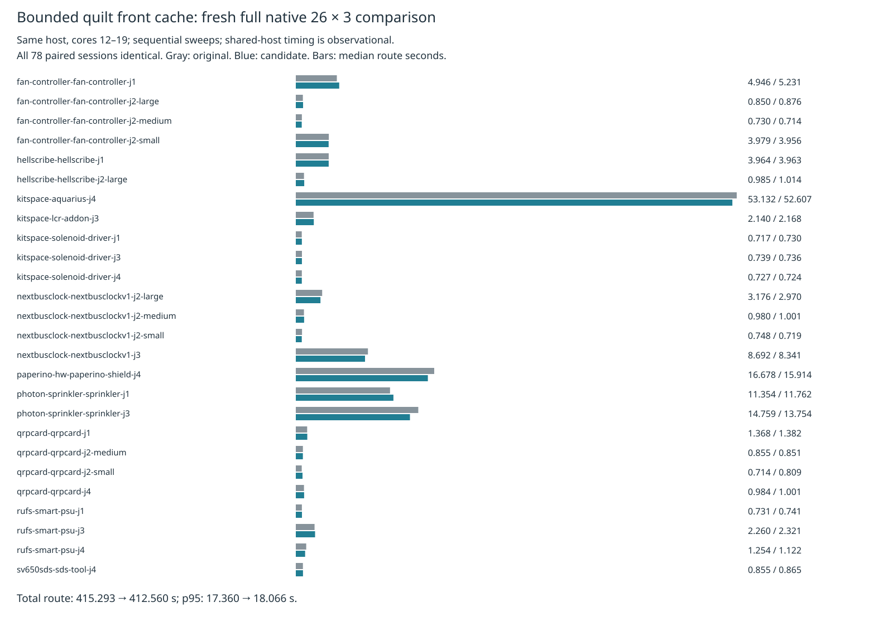

# Reverse-order timing replication

This cycle repeats the unchanged bounded quilt front cache against the same isolated original engine, on the same host and cores 12–19, with nice 10. The candidate sweep runs **first**, then the original; each completes all frozen 26 cases × three repeats without an overlapping own heavy job. The prior cycle ran original first. Both sources enable local recovery identically. Only `src/route/quilt.ts` differs; no engine code changes in this replication.

The previous 11.56% reduction in total route time does **not** replicate at that magnitude. This pair changes total route time by −0.66%, aggregate median by +0.15%, p95 by +4.07%, and sweep wall time by +0.16%. Summed case medians fall 1.48%, but summed case p95 rises 3.70%. Only 13 of 26 case medians and 9 of 26 case p95 values improve. Shared-host timings remain observational; do not claim a proven or universal speed gain. Keep this mixed result alongside the [earlier original-first pair](../quilt-front-native/README.md).

All 78 paired sessions and final engine statistics match exactly. Passed counts, opens, via counts, length, native error multiplicities, warning geometry, and fidelity do not regress. Both retain 27 known native thermal errors; this is not a DRC-clean suite.

| Full native metric (26 cases × 3 repeats) | Original | Front cache |
|---|---:|---:|
| Passed / 78 | 48 | 48 |
| Valid cases / 26 | 16 | 16 |
| Opens | 90 | 90 |
| New native errors (known, unresolved) | 27 | 27 |
| Median route seconds | 1.066284 | 1.067890 |
| p95 route seconds | 17.360232 | 18.066149 |
| Sum route seconds | 415.292785 | 412.560449 |
| Sweep wall seconds | 525.427026 | 526.245477 |
| Sum case medians seconds | 138.318255 | 136.271235 |
| Sum case p95 seconds | 142.866753 | 148.147979 |
| Sum vias | 2826 | 2826 |
| Sum length mm | 60450.378202 | 60450.378202 |

[All per-case median/p95 and outcomes](table.md). Aggregate p95 is order statistic 75 of 78; per-case p95 is the maximum of three.



The lossless archive includes all 156 native checks, run records, DSN/SES, manifests, settings and engine reports, plus controls, results, summaries, logs, source inventories and supervisor exits. Archived original/candidate check logs are the prerequisite gates from the preceding cycle; fresh production gates for this cycle are recorded separately below. The source hashes are unchanged. All four corruption controls (missing repeat, changed session, added finding and changed effective settings) are rejected.

Reproduce using the preparation in [the prerequisite experiment](../quilt-front/README.md), then reverse the sweep order:

```sh
p=docs/pr-assets/agent-fab-router-perf-local-rescue/quilt-front
w=/home/hyper/bench/agents/codex-fabpcb-perf/scratch/reverse-repro
mkdir -p "$w"
python3 "$p/prepare.py" "$w/work"
for mode in candidate original; do
  python3 "$p/native-run.py" "$w/work" "$HOME/bench/wt/fp-perf" "$mode"
done
```

Each sweep executes from the benchmark worktree:

```sh
taskset -c 12-19 nice -n 10 timeout --kill-after=5 3000 python3 benchmarks/autorouter/benchmark.py --router fab-router --fab-router-source SOURCE/entry --out OUTPUT
```

Replay this committed archive without native tools or routing:

```sh
PYTHONDONTWRITEBYTECODE=1 python3 docs/pr-assets/agent-fab-router-perf-local-rescue/quilt-front-reverse/verify.py
```

Frozen cases, physical rules, checker, scoring and shared runtime are unchanged. These exported-engine measurements do not measure application exporter or live editor behavior.

## Counterbalanced dense replication

Three fresh paired repeats use identical two-pass/600-second budgets, local recovery enabled, and candidate-first / original-first / candidate-first order. Every attempt is checked; none time out. All six sessions are byte-identical, and final engine statistics match pairwise. No native finding, warning geometry or fidelity regression is introduced. The board remains incomplete:181 opens on every attempt, zero new native errors,315 vias and2317.561458mm each. This is a separate stress measurement, not a frozen-suite score.

| Repeat | Execution order | Original route s | Front cache route s | Opens each | New errors each |
|---|---|---:|---:|---:|---:|
| 1 | candidate → original | 164.694350 | 164.739316 |181|0|
| 2 | original → candidate | 169.359386 | 157.187184 |181|0|
| 3 | candidate → original | 163.126189 | 159.650450 |181|0|
| Median | Three repeats/mode | 164.694350 | 159.650450 |181|0|
| p95 (max of3) | Three repeats/mode | 169.359386 | 164.739316 |181|0|

Dense median falls3.06% and p95 falls2.73%. This does not erase the earlier single pair's10.08% slowdown. Between-pair variability and the mixed frozen-suite replication limit any general speed claim. All six native checks, records, inputs, sessions, manifests, reports, source hashes and fixture checksums are retained in `dense-raw.json.gz`; the comparator reconstructs its summary from those records.

Reproduce after preparing the isolated original and candidate sources:

```sh
n=docs/pr-assets/agent-fab-router-perf-local-rescue/quilt-front-reverse
taskset -c 12-19 nice -n 10 timeout --kill-after=5 4800 python3 "$n/dense-native.py" "$HOME/bench/wt/fp-perf/benchmarks/autorouter" SOURCE/original SOURCE/candidate "$HOME/bench/boards/dense/fab_pcb-case-dense6-bga324-j1" OUTPUT
python3 "$n/compare-dense.py" OUTPUT SOURCE/original SOURCE/candidate COMPARISON.json
PYTHONDONTWRITEBYTECODE=1 python3 "$n/verify-dense.py"
```

The replay verifier uses immutable engine revisions `d62ccee9` and `790256b1` from this Git repository. It rejects missing dense attempts and altered raw checker records.

## Fresh production checks

The unchanged production engine passes `bun run typecheck && bun run check:layers && bun run test`:71 layer-checked files, zero layer violations,912 passing tests,399,733 assertions, zero failures (340.64 seconds for tests). `fresh-checks.log.gz` and `fresh-checks-exit.json` retain this cycle's full gate. It runs after all measured native attempts, on cores12–19 with nice10 and a900-second outer timeout. No tests or rules are weakened.
