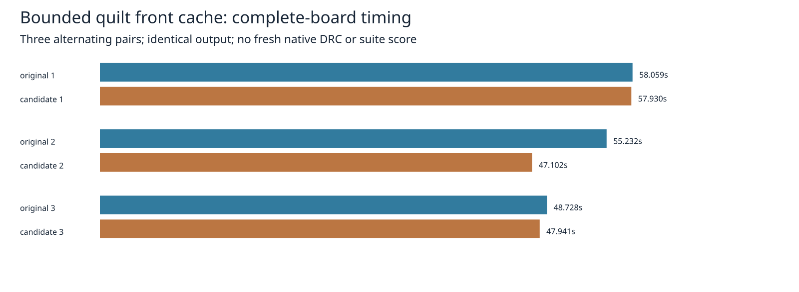

# Bounded quilt front-cache experiment

The earlier observer found 81.17% simulated coverage with 1,024 slots per quilt. This distinct candidate actually bypasses Map lookups on front hits. Each quilt allocates 1,024 numeric keys and byte states; the original Map remains authoritative on misses and for decided-cell count and invalidation. Every invalidation clears all front states, including empty and partial invalidations. Numeric Map key semantics remain unchanged; NaN keys conservatively miss the front. The measured candidate is captured independently from production. Preparation pins original revision `d62ccee9` so reproduction remains stable after adoption.

Three sequential alternating complete-board pairs use the archived input and enabled recovery settings, cores 12–19, nice 10, individual 300-second timeouts. Allocation is included. All six sessions, settings, final statistics and reports except wall time match the independent archived control. Recovery logs match excluding only nested seconds. Original times are 58.059355 / 55.232355 / 48.727961 seconds; candidate times are 57.929510 / 47.102429 / 47.941250 seconds. Median changes 55.232355 → 47.941250 seconds (−13.20%). Each pair favors the candidate, but shared-host observations do not establish causality or predict suite speed.

A differential stub-clearance trace checks 40,092 queries and 24 invalidations, including negative/fractional coordinates, numeric aliases, collisions, NaN, infinities, large coordinates and partial/full/empty invalidation. It compares decisions, callback counts, decided counts and point coordinates. Three deliberately broken variants (no invalidation, no key check, incorrect blocked result) are rejected. This trace checks cache behavior, not geometric clearance. Source audit covers 1,536 implementation/spec/test files against an independent historical snapshot; only quilt.ts differs. Reversing exactly the candidate substitutions restores the original module hash. Independent preparation reproduces all hashes and candidate bytes. Finite API coverage is not a universal proof.

Both production and candidate pass typecheck, layer checks (71 files, zero violations) and 912 tests / 399,733 assertions, zero failures. Test runs take 351.93 / 350.03 seconds and occur after timing replays. The separate [fresh full native comparison](../quilt-front-native/README.md) decides whether this candidate warrants adoption. Existing native thermal errors are unresolved; matching the archived engine control alone is not a fresh native DRC result.



Exact reproduction, repository root, unused work directory:

```sh
p=docs/pr-assets/agent-fab-router-perf-local-rescue/quilt-front
s=/home/hyper/bench/agents/codex-fabpcb-perf/scratch/quilt-front-repro
mkdir -p "$s"
python3 "$p/prepare.py" "$s/work"
taskset -c 12-19 nice -n 10 timeout 30 bun "$p/controls.ts" "$s/work/original" "$s/work/source"
python3 "$p/mutation.py" "$s"
python3 "$p/run.py" "$s"
PYTHONDONTWRITEBYTECODE=1 python3 "$p/report.py" "$s" "$p"
rsvg-convert -w 1600 "$p/chart.svg" -o "$p/chart.png"
for mode in original candidate; do
  python3 "$p/native-run.py" "$s/work" "$HOME/bench/wt/fp-perf" "$mode"
done
n=docs/pr-assets/agent-fab-router-perf-local-rescue/quilt-front-native
PYTHONDONTWRITEBYTECODE=1 python3 "$n/collect.py" "$s"
```

Archived evidence can be checked without routing:

```sh
PYTHONDONTWRITEBYTECODE=1 python3 docs/pr-assets/agent-fab-router-perf-local-rescue/quilt-front/verify.py
```

The PNG was visually inspected. Bounded capacity per quilt does not establish a bound on simultaneously live quilts or net memory savings. Earlier lattice cache/key experiments target a different module and remain separate.

Completed additional validation: dense native one paired repeat with identical sessions, 181 opens, zero new native errors, 315 vias and 2317.561458 mm length. Dense route time rises 160.963 → 177.181 seconds (+10.08%); this negative single observation is retained. L2/L3 paired engine replays have exact sessions/statistics/reports except time, 21/153 incomplete connections and zero added engine violations. Times are 19.729 → 19.963 and 177.275 → 177.825 seconds. Ladder results have no fresh native score.

The complete enabled slow sweep evaluates all 63 unchanged acceptance cases: 51 pass, 12 retain recorded failures, 14 advisory results, no stubs and zero adverse completion/added-violation/invariant changes relative to the historical matching-pin control. This is a fresh candidate sweep against a historical control, not fresh paired slow timing; its 2420.617 seconds versus historical 2488.515 seconds is not a causal speed claim. All 99 captured historical runtime files match the measured original, and acceptance tools/fixtures are unchanged from that pin.

Lossless additional evidence is in `dense-raw.json.gz`, `dense-comparison.json`, `ladder-records.json.gz` (including inputs) and `slow.json.gz` / `slow-comparison.json`. Verify independently:

```sh
PYTHONDONTWRITEBYTECODE=1 python3 docs/pr-assets/agent-fab-router-perf-local-rescue/quilt-front/verify-stress.py
```

Reproduce dense with the private runtime and the prepared fixture:

```sh
p=docs/pr-assets/agent-fab-router-perf-local-rescue/quilt-front
taskset -c 12-19 nice -n 10 timeout --kill-after=5 1800 python3 "$p/dense-native.py" "$HOME/bench/wt/fp-perf/benchmarks/autorouter" "$s/work/original" "$s/work/source" "$HOME/bench/boards/dense/fab_pcb-case-dense6-bga324-j1" "$s/dense"
for case in l2 l3-cycle18; do
  for mode in original candidate; do
    taskset -c 12-19 nice -n 10 timeout --kill-after=5 900 bun "$p/stress.ts" "$s/work/$mode" "$HOME/bench/boards/ladder/$case.dsn" "$s/$case-$mode"
  done
done
taskset -c 12-19 nice -n 10 timeout --kill-after=5 5400 bun docs/pr-assets/agent-fab-router-perf-local-rescue/point-components/slow.ts "$s/work/source" "$s/slow.json"
```

The slow driver calls the unchanged acceptance harness with recovery enabled and retains all expected failures; its process exit is not an all-cases-pass claim. Dense and ladder checks use two-pass/600-second budgets and do not time out. Three stress-evidence corruption controls are rejected by the archive verifier.
