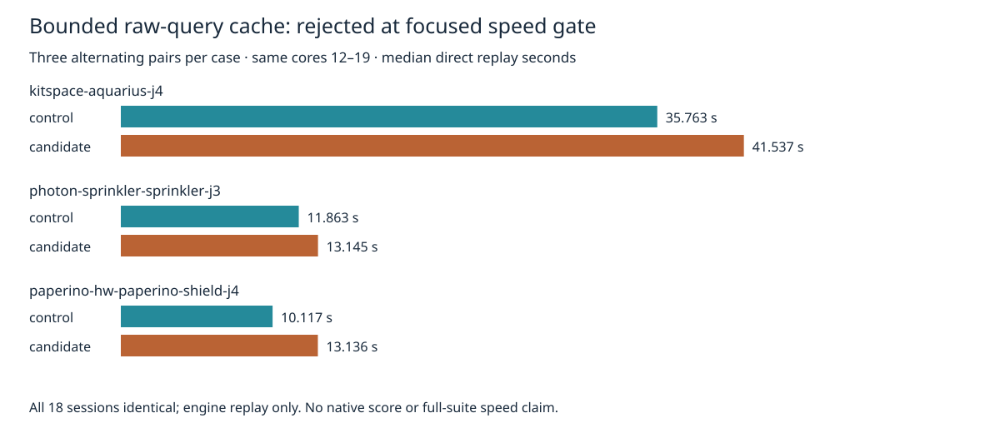

# Rejected bounded raw-query cache experiment

The prior raw-query recurrence census motivated a real caching experiment. This package retains the rejected candidate and all 18 fresh direct replays. Production source, tests, physical rules, settings and defaults are unchanged. No speed gain is claimed.

The candidate adds a 256-entry direct-mapped cache of unfiltered lattice hits. Numeric hashes select an entry; exact sheet, mode, axis and sweep diagonal comparisons determine a hit. Every slot allocation/release/rebuild clears entries. Filtered queries clear the cache and call the original collector with the original callback, preserving callback evaluation and traversal order. Cached arrays and each reference are copied so callers cannot corrupt future results. The original collector is unchanged. This is distinct from the prior rejected raw-collector and predicate-lift experiments.

Same machine (hyper-ms-lin), cores 12–19, nice 10, same seed-1 inputs/settings: 100 passes, optimizer enabled, recovery unset. Three pairs per case, control/candidate then candidate/control then control/candidate; cases run sequentially, no own heavy checks overlap. `p95` is nearest-rank and therefore the maximum of only three repeats. These are direct engine replay times, not native harness timings.

| Case | Control median / p95 s | Candidate median / p95 s | Median change | Engine incomplete before → after | Represented additions before → after |
|---|---:|---:|---:|---:|---:|
| Aquarius J4 | 35.762832 / 36.313476 | 41.536716 / 42.131408 | +16.14% | 8 → 8 | 0 → 0 |
| Sprinkler J3 | 11.863135 / 13.280649 | 13.144669 / 14.301468 | +10.80% | 2 → 2 | 0 → 0 |
| Shield J4 | 10.117212 / 10.133767 | 13.135876 / 13.562900 | +29.84% | 6 → 6 | 0 → 0 |

Sum of nine durations: 174.614812 → 204.840679 seconds (+17.31%). All 18 complete sessions are byte-identical to the adjacent immutable retained references. Settings and full results/statistics/diagnostics match after removing **only** `result.report.wallClockMs`. Engine incomplete/represented violations are not native scores. No fresh native/full 26×3/dense/ladder/slow acceptance run: the focused speed gate rejects this candidate before adoption. Existing native thermal errors and adverse L3 tail remain unresolved; recovery remains disabled by default. These observations do not isolate hashing, copying, invalidation or collision costs, nor prove all possible caches would be slower.



The base complete source archive, inputs, licenses and provenance live in adjacent `default-slow-profile`. `source-audit.json` verifies complete src/spec hashes; only candidate `src/lattice/grid.ts` differs. The exact candidate is retained compressed and reconstructs from `prepare.py`. Raw timings, process logs, full sessions and reports retain every attempt. No attempts timed out or were dropped.

Reproduce from repository root with installed Bun, Python and rsvg-convert (new directory only):

```bash
ASSET="$PWD/docs/pr-assets/agent-fab-router-perf-local-rescue/raw-query-cache"
PYTHONDONTWRITEBYTECODE=1 python3 "$ASSET/reproduce.py" /tmp/raw-query-cache-new
PYTHONDONTWRITEBYTECODE=1 python3 "$ASSET/verify.py"
PYTHONDONTWRITEBYTECODE=1 python3 "$ASSET/test-verify.py"
python3 "$ASSET/plot.py"
taskset -c 12-19 nice -n 10 timeout --kill-after=10 1800 bash -c 'bun run typecheck && bun run check:layers && bun run test'
```

`--prepare-only` reconstructs both sources and runs the exact candidate/control differential test without routing. Independent reconstruction matched every src/spec hash. The differential test passes 61,078 assertions covering stateful mutation, slot reuse, rebuilds, arrays/reference ownership, sheets/modes/diagonals, colliding numeric keys and callback ordering/mutable filters. Candidate typecheck and existing lattice tests pass (7 tests, 39,753 assertions). The rejected candidate full suite was not run. Existing candidate-test sources are retained compressed; they were copied unchanged from the repository. Semantic verifier corruption controls reject changed sessions/reports/source and a missing attempt even after updating the package manifest hash for the changed file.

Initial plotting attempted an unavailable optional Python library; no installation was made. The final standard-library SVG generator uses existing rsvg-convert; the resulting PNG was visually inspected.

Final repository checks: typecheck PASS; 71 layer files / zero violations; 914 tests / zero failures / 649747 assertions. Complete logs retained.
