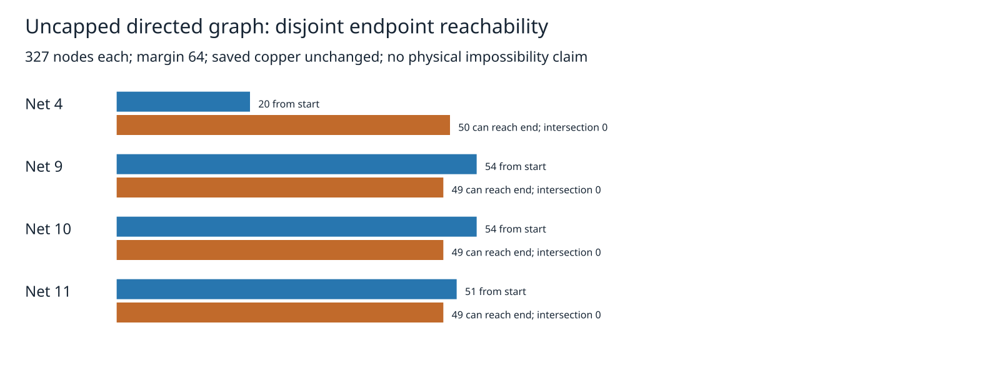

# Directed reachability on four uncapped residual graphs

The preceding candidate census found four uncapped graphs with both legal start exits and end entries. This read-only diagnostic resolves whether a path exists between those endpoint components. Production remains `8e53e7d`; defaults, rules, budgets, frozen cases, copper, tests and consumer pin are unchanged.

All four saved seed-1 residual targets on the shield board are inspected at margin64, on their single common sheet. The 327 nodes include two endpoints and all 325 unique corners. Every ordered pair of distinct nodes is classified using production `legaliseTrail` plus full-copper region containment: **426,408 directed checks** across four graphs. The graph is directed because legalisation can depend on orientation. An independent stack traversal verifies the driver's breadth-first forward traversal; reverse traversal identifies all nodes that can reach the end.

| Net | Nodes | From start | Can reach end | Intersection | Reachable repeats |
|---|---:|---:|---:|---:|---:|
| 4 | 327 | 20 | 50 | 0 | 0/3 |
| 9 | 327 | 54 | 49 | 0 | 0/3 |
| 10 | 327 | 54 | 49 | 0 | 0/3 |
| 11 | 327 | 51 | 49 | 0 | 0/3 |

All three complete outputs are byte-identical. Nodes/input hashes and endpoint-edge counts match the prior census, whose node ordering was independently checked against production. Missing rows, changed node coordinates, an inserted false path and a false reachability flag are rejected by the report validator. [Validation](validation.json), [raw adjacency and nodes](results.json.gz), [per-graph table](cases.md), [source hashes](source-audit.json).



A larger search budget cannot connect these particular graphs. This does **not** establish physical unroutability, impossibility on other regions/layers/candidate sets, or a successful relaxed route. No vias, alternative anchors, rip-up or rule changes are considered. No insertion/terminal-acceptance or native DRC validation is attempted. Layout and session serialization are identical before/after, with zero engine exact violations. Existing 27 known native errors remain unresolved. This is not a new native benchmark, speed result or closure gain; no history score is duplicated. The 426,408 checks are diagnostic work, not production's charged shared work ledger, and are not subject to its search budget.

The appropriate next experiment changes legal graph coverage (for example obstacle-edge waypoints), rather than repeating larger budgets on this fixed graph. It must retain the shared budget and deadline plus exact/original-terminal/full-copper rollback gates. No such policy is adopted here. Separate endpoint work remains independent.

## Reproduce

Run from the engine worktree, using the cycle42 native-after-run directory or the native reconstruction commands in [the prior census](../candidate-coverage/README.md):

```bash
ASSET=docs/pr-assets/agent-fab-router-perf-local-rescue/reachability
NATIVE=/home/hyper/bench/agents/codex-fabpcb-perf/scratch/cycle42/native-after-run
OUT=/home/hyper/bench/agents/codex-fabpcb-perf/scratch/repro46
mkdir -p "$OUT"
for repeat in 1 2 3; do
  taskset -c 12-19 nice -n 10 timeout 1200 bun "$ASSET/run.ts" "$NATIVE" "$OUT/reach-$repeat.json"
done
python3 "$ASSET/verify.py" "$OUT"
python3 "$ASSET/report.py" "$ASSET/results.json.gz" "$OUT/report"
rsvg-convert -w 1600 "$OUT/report/reachability.svg" -o "$OUT/report/reachability.png"
cmp "$ASSET/reachability.svg" "$OUT/report/reachability.svg"
cmp "$ASSET/reachability.png" "$OUT/report/reachability.png"
taskset -c 12-19 nice -n 10 timeout 1800 bash -c 'bun run typecheck && bun run check:layers && bun run test'
```

`verify.py` validates the three repeat files, compares prior census hashes/counts, runs four negative controls and checks all 77 runtime/spec source hashes. It rewrites the reproducible archive and validation/source reports in this asset directory. Report-only replay requires just the committed compressed adjacency archive, Python standard library and `rsvg-convert`; no routing is needed. Required checks are recorded alongside this evidence.

Required checks completed: typecheck PASS; 71 layer-checked files, zero violations; 912 tests, zero failures, 399733 assertions in 336.42 seconds. Supervisor exit0. [Full log](checks.log.gz).
