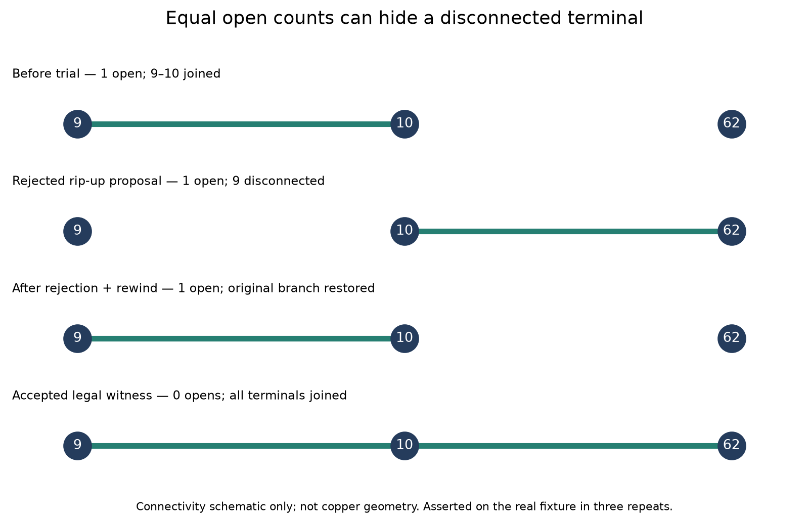

# Exact recovery transaction prerequisite, cycle 25

The research harness now checks a proposed recovery against the complete exact
DRC and every previously connected terminal group before retaining it. Failed
proposals and thrown exceptions rewind the Journal. This is a standalone,
explicitly invoked research helper, **not production recovery or a public setting**.
No production source, rule, search budget, lattice or route decision changes.

The real ten-pad fixture exposes why a global incomplete count is insufficient:
closing 10→62 while removing the existing 9→10 branch leaves one incomplete
connection, yet loses a previously joined pair. The terminal guard rejects it.
The legal recorded raw witness is accepted with all three terminals joined.



Same fixture/settings/machine, cores 12–19, three normal-pipeline repeats in the
final control test, each followed by these five proposals:

| Proposal | Gate outcome in each repeat | Target opens after outcome | Exact violations after outcome |
| --- | --- | ---: | ---: |
| No copper added | open; rewind | 1 | 0 |
| Witness added, then exception | rethrow; rewind | 1 | 0 |
| Witness plus deliberate foreign-pad collision | DRC; rewind | 1 | 0 |
| Witness plus short-branch rip-up | terminal preservation; rewind | 1 | 0 |
| Legal full-width witness | kept | 0 | 0 |

The final control passes 138 assertions across all three repeats. Three deliberate
bypass controls each fail at the expected assertion in their first repeat:
disabling exact DRC retains the colliding proposal, disabling terminal preservation
retains the disconnected proposal, and disabling rewind leaves the interrupted
proposal in the session. These are mutation tests of the new harness, not
historical engine defects. [Raw logs and source hashes](transaction-checks/results.json).

Required checks pass: typecheck, layer checks (65 files, zero violations), and
860 tests / 398592 assertions. The full test suite took 229.89 seconds on the
shared host; this is validation time, not a performance measurement.

Rejections preserve the exact session, target connectivity and zero violations;
the legal witness remains legal when queried through the same live lattice.
The deliberately colliding track disappears from the lattice directory. A final
accepted witness is explicitly rewound by the test as well. Journal IDs remain
monotonic: rollback restores copper/connectivity/session, not allocator history.

Contract: a synchronous proposal must change copper **only through the supplied
Journal**, without editing rules, pads, pours, or other layout fields. This helper
is not a sandbox for arbitrary callbacks. It requires zero baseline exact
violations, a valid initially disconnected target, and preserves terminal groups
on all nets (including ignored nets and non-prior pours). Exact DRC is the
engine's represented rule set; it does not prove native zone-refill safety.
Proposals must also preserve non-router copper; ownership enforcement and
byte-preservation checks belong in the future production integration. The
tested rip-up removes only the router-generated short branch.

The full-pipeline regression permits future normal legal closure. If that happens,
its witness-specific section is skipped; the evidence runner's assertion-count
check intentionally requires review rather than silently reporting unexercised
transaction coverage.

Reproduce from the router checkout, with an unused output directory:

```sh
taskset -c 12-19 nice -n 10 timeout 120 bun test test/near-complete-endpoint.test.ts
python3 docs/pr-assets/agent-fab-router-perf-local-rescue/validate-recovery-transaction.py \
  "$PWD" /tmp/recovery-transaction-new
taskset -c 12-19 nice -n 10 timeout 900 bash -c \
  'bun run typecheck && bun run check:layers && bun run test'
```

The reproduction runner creates disposable trees, runs only its own processes
with timeouts, refuses an existing output directory, and verifies that the
captured test/helper did not change. It does not edit production source.

Regenerate the schematic with Python and Matplotlib, using an unused output path:

```sh
python3 docs/pr-assets/agent-fab-router-perf-local-rescue/plot-recovery-transaction.py \
  docs/pr-assets/agent-fab-router-perf-local-rescue/transaction-checks/results.json \
  /tmp/recovery-terminal-states-new.png
```

No speed or native completion improvement is claimed. The original-context raw
retry still fails to close the target, and the global retry still changes an
existing fingerprint. Local post-pass integration, region/budget enforcement,
original-board success, dense6/ladder/slow validation and native-rule validation
remain required before adopting a general recovery mechanism.

Full **unchanged-production** native verification, same 26 cases × 3 repeats and machine/cores, against the prior cycle control. All 78 sessions, quality outcomes, via counts and lengths match exactly. Production source hashes, inputs, settings, runtime, checker and order match.

| Native metric | Prior control | Current unchanged production |
| --- | ---: | ---: |
| Passed / valid 3-of-3 cases | 39/78 / 13/26 | 39/78 / 13/26 |
| Opens | 120 | 120 |
| New native errors | 27 | 27 |
| Attempt median / p95 seconds | 1.106 / 16.966 | 1.061 / 15.846 |
| Total route seconds | 382.816 | 372.638 |

Existing thermal errors remain unresolved: **not native DRC clean**. No speed gain is claimed. [All per-case median/p95, quality, via and length results](https://github.com/fabPlane/fab_router/blob/agent/fab-router-perf-local-rescue/docs/pr-assets/agent-fab-router-perf-local-rescue/transaction-checks/native-tables.md).

Native reproduction: the unchanged-production command in the PR body, output to a new directory. Compare with `python3 docs/pr-assets/agent-fab-router-perf-local-rescue/compare-normal-native.py BEFORE AFTER SOURCE UNUSED_OUTPUT`.
