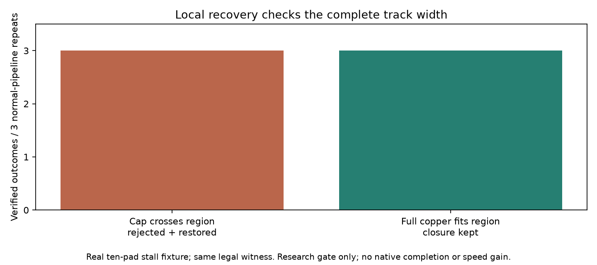

# Local copper containment prerequisite — cycle 27

The standalone research transaction accepts an optional closed XY region. Every
changed track or barrel must fit completely within it, considering both its old
and new geometry. Tracks include every stroked leg and round end cap; barrels
include copper on every represented sheet and the drill disk. Missing barrel
forms or empty tracks fail containment. Invalid region bounds throw before the
proposal callback runs. Existing ownership, exact DRC, terminal preservation,
target closure and Journal rollback checks remain in force.

This checks the **final copper delta**, not every intermediate Journal operation.
An unchanged remote object is allowed. A removed remote object, a replacement
whose old geometry was remote, or an inserted remote object is rejected. It is
an optional research API, not production routing, a search scheduler, an enforced
operation budget, or a sandbox for arbitrary callbacks. The caller still supplies
the region; endpoint/pitch construction and gradual expansion are not integrated.
Trusted synchronous callbacks must only mutate copper through the supplied Journal,
with pads, rules, forms, pours and other fields immutable. No safety margin changes.



Same real ten-pad fixture, settings, machine and cores 12–19, three complete normal
pipeline repeats followed by each proposal:

| Legal recorded closure | Without region check (deliberate bypass) | With region check |
| --- | --- | --- |
| Region clips 0.5 LU of the track end cap; all vertices inside | accepted; regression fails in first repeat | rejected and restored 3/3 |
| Closed box contains full track width at equality | not separately bypassed | kept, zero exact violations and target opens 0, 3/3 |

The rejected proposal itself closes the target and has zero exact violations;
containment adds an independent acceptance condition. Rejection restores the exact
session, target connectivity, live lattice directory and empty insertion list.
The accepted proposal is explicitly rewound afterward. The real-fixture test
passes 267 assertions. The synthetic tests pass 68 assertions, including remote
removal, replacement with the same id, remote insertion, track cap boundaries,
a one-point track, an asymmetric two-sheet via, drill extent beyond copper,
missing form, and invalid regions before callback invocation. The synthetic
remote proposals also close their target with zero exact violations before rejection.

Five deliberate gate bypasses fail their intended real-fixture assertion in the
first repeat. The region bypass additionally fails the synthetic remote-removal
trial; replacement and insertion do not run under that failed mutation, so no
separate bypass coverage is claimed. These are sensitivity checks of the research
helper, not historical production defects. [Logs and source hashes](region-checks/results.json).
An early synthetic test used the wrong lattice directory field (`ref` rather than
`item`); corrected before the captured validation and full checks. No route
measurements were discarded.

Reproduce from the router checkout with an unused output path:

```sh
python3 docs/pr-assets/agent-fab-router-perf-local-rescue/validate-recovery-transaction.py \
  "$PWD" /tmp/recovery-region-new
taskset -c 12-19 nice -n 10 timeout 900 bash -c \
  'bun run typecheck && bun run check:layers && bun run test'
python3 docs/pr-assets/agent-fab-router-perf-local-rescue/plot-region.py \
  docs/pr-assets/agent-fab-router-perf-local-rescue/region-checks/results.json \
  /tmp/recovery-region-new.png
```

Production source and default route decisions are unchanged. Exact geometry safety
does not establish native refill safety. There is no performance or native closure
gain, nor downstream pin bump. Local post-pass scheduling, per-connection budgets,
original-board recovery, and full candidate native/dense6/ladder/slow validation
remain required before general adoption. Earlier transaction and ownership reports
refer to their original captured helper versions; this report supersedes their
statement that all region enforcement is pending.
