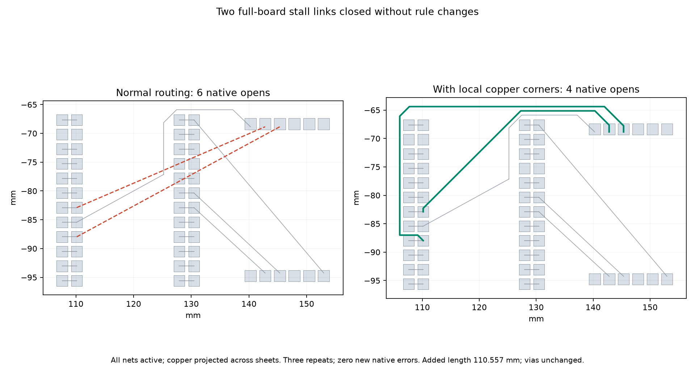

# All-net local recovery research

This experiment routes every net in the original 60-pad stall fixture before
collecting its actual remaining connections. It replaces the isolated-net assumption
with live foreign copper as obstacles, resolves each target's own profile, preserves
ignored-net obstacles and runs the existing local transaction for each target.
No production source or default setting changes. The explicit adapter under
`candidate/src/api.ts` is only selected by a research benchmark invocation.

The existing pad-only graph leaves all six connections open, three of three
repeats. Adding optional bounding-box corners around foreign track segments and
barrels closes nets 6 and 8 in every repeat, at the 8-pitch region step. Net 4,
which closed with isolated routing, remains open with all nets active. Sweeping
the prior isolated route against the normal all-net session finds three blocked
legs and four foreign-track blockers; the isolated proof does not transfer.

Both graph variants use endpoint boxes grown through 0/4/8/16 pitches, at most
512 nodes per sheet, and a shared 100000 charged-work/15-second cooperative budget
per connection. The collector caps targets at 16 and skips unsupported non-pad
endpoints, disabled routing, ignored targets and an exact-dirty baseline. It
rechecks each target's current connectivity before trying it. The research adapter
also skips aborted/timed-out normal runs and respects the normal remaining item
cap. This is insertion only: full net-class width, existing angle shaping and
exact clearance predicates, no rip-up, vias, necking, margin or rule reductions.

The transaction validates retained copper, full copper containment in the local
region, exact DRC, every previously joined terminal group and actual target closure.
Misses and failures rewind through the live Journal. The graph is incomplete and
input ordered; reaching a node cap or exhausted region sequence does not establish
that no legal path exists. There is no whole-route deadline/abort propagation into
research recovery and no hard bound on validation time. Those are prerequisites
for any production integration, not claims of this adapter.

One frozen board, all nets active, same host/cores 12–19 and same seed/settings,
three independent normal routing repeats per variant. Native checking uses the
unchanged export/import/checker on both captured sessions from each copper-corner
repeat; inputs, project, custom rules and checker hashes are verified unchanged.

| Metric per repeat | Normal routing | Pad-only recovery | Copper-corner recovery |
| --- | ---: | ---: | ---: |
| Engine incomplete connections | 6 | 6 | 4 |
| New native errors | 0 | Not checked separately | 0 |
| Native opens | 6 | Same session as normal | 4 |
| Native board integrity | Pass | Same session as normal | Pass |
| Passed repeats | 0/3 | 0/3 | 0/3 |
| Track length mm | 171.235 | 171.235 | 281.792 |
| Vias | 1 | 1 | 1 |

The two closures add 110.557 mm: there is no completed-route length comparator or
speed claim. Four opens remain. Final pad-only added-recovery median/p95 seconds
are 0.643/0.643; copper-corner recovery 0.805/0.825. With three samples p95 is the
maximum. Normal-route timing varied across batches on the shared host and overlapped
tests/native work. Timing is additional recovery cost, not isolated performance.



[Final pad-only measurements](remaining-checks/whole-board-final.json),
[final copper-corner measurements](remaining-checks/whole-board-copper-final.json),
[paired native results and exact commands](remaining-checks/native-pair/results.json),
[isolated route collision diagnostic](remaining-checks/isolated-vs-whole.json),
[collector controls](remaining-checks/results.json) and
[source hashes](remaining-checks/source-hashes.json) retain the evidence. Three
synthetic tests verify per-net widths, ignored nets, target caps and copper-corner
detours; a fourth real all-net adapter test verifies exactly two closures with no
added exact violations. Omitting copper-corner generation breaks its regression.
The native board artifacts retain their input license beside the results.

## Reproduce

Run from this repository; every output argument must be unused. Use the private
benchmark checkout with its existing runtime; do not modify frozen inputs.

```bash
taskset -c 12-19 nice -n 10 timeout 900 bun docs/pr-assets/agent-fab-router-perf-local-rescue/run-remaining.ts /tmp/pad-only.json
taskset -c 12-19 nice -n 10 timeout 900 bun docs/pr-assets/agent-fab-router-perf-local-rescue/run-remaining.ts /tmp/copper-corners.json copper
taskset -c 12-19 nice -n 10 timeout 900 python3 docs/pr-assets/agent-fab-router-perf-local-rescue/check-remaining-native.py "$HOME/bench/wt/fp-perf" /tmp/copper-corners.json /tmp/paired-native
taskset -c 12-19 nice -n 10 timeout 180 python3 docs/pr-assets/agent-fab-router-perf-local-rescue/validate-remaining.py "$PWD" /tmp/collector-controls
taskset -c 12-19 nice -n 10 timeout 240 bun test test/recovery-candidate.test.ts
bun run typecheck && bun run check:layers && bun run test
```

For the complete native comparison, run sequentially from the benchmark checkout
(the harness holds an exclusive run lock):

```bash
cd "$HOME/bench/wt/fp-perf"
taskset -c 12-19 nice -n 10 timeout 7200 python3 benchmarks/autorouter/benchmark.py --router fab-router --fab-router-source "$HOME/bench/wt/fr-perf" --out /tmp/normal-native
taskset -c 12-19 nice -n 10 timeout 7200 python3 benchmarks/autorouter/benchmark.py --router fab-router --fab-router-source "$HOME/bench/wt/fr-perf/docs/pr-assets/agent-fab-router-perf-local-rescue/candidate" --out /tmp/research-native
cd "$HOME/bench/wt/fr-perf"
python3 docs/pr-assets/agent-fab-router-perf-local-rescue/compare-remaining-native.py /tmp/normal-native /tmp/research-native "$PWD" /tmp/compared-native.json
```

Larger-input comparison (three repeats/mode/input, two normal passes, 120-second
normal route budget; native DRC and slow acceptance are separate):

```bash
taskset -c 12-19 nice -n 10 timeout 3600 bun docs/pr-assets/agent-fab-router-perf-local-rescue/run-remaining-large.ts /tmp/large.json "$HOME/bench/boards/ladder/l2.dsn" "$HOME/bench/boards/ladder/l3-cycle18.dsn" "$HOME/bench/boards/dense/dense6-bga324.dsn"
python3 docs/pr-assets/agent-fab-router-perf-local-rescue/plot-remaining.py /tmp/copper-corners.json /tmp/paired-native/results.json /tmp/connection.png
```

The plot requires an existing Python environment with matplotlib. No generated
image or captured path is an input to the search. The normal route remains the
fallback; a research-only success does not enable recovery in production.

## Search work profile

Counts are deterministic cooperative work, not sampled CPU or heap allocation.
All three final repeats give these same counts. The two accepted routes retain
their full shaped vertices; the normal copper remains unchanged.

| Net id | Outcome | Charged work | Directed edges checked | Closing margin |
| --- | --- | ---: | ---: | ---: |
| 4 | exhausted | 31278 | 29665 | — |
| 6 | kept | 14743 | 13561 | 8 |
| 8 | kept | 23939 | 22626 | 8 |
| 9 | exhausted | 40585 | 38668 | — |
| 10 | exhausted | 43942 | 42018 | — |
| 11 | exhausted | 42656 | 40739 | — |

## Complete native comparison

Both runs use all 26 frozen cases × seeds 1/2/3, same host/cores 12–19, unchanged
input/settings/runtime/checker/order. The current normal-source sweep matches all
78 sessions and quality metrics from the prior cycle. The after sweep explicitly
selects the research adapter; all production defaults remain unchanged. Fifteen
sessions change across five cases, with the same closure gain on each seed. The
other 63 sessions match exactly. All attempts preserve native fidelity. New-error
details are compared by complete structured records, not just total counts; no
candidate error is introduced or substituted for an earlier finding.

| Metric, 78 attempts | Normal | Explicit research adapter |
| --- | ---: | ---: |
| Passed / cases valid 3-of-3 | 39/78 / 13/26 | 39/78 / 13/26 |
| Native opens | 120 | 99 |
| New native errors relative to frozen input | 27 | 27 |
| Attempt median / p95 seconds | 1.259 / 17.476 | 1.122 / 20.910 |
| Total route seconds | 421.212 | 436.166 |
| Total vias, summed across attempts | 2826 | 2826 |
| Total length mm, summed across attempts | 58809.321 | 60080.812 |

Opens improve 17.5%; no additional board passes. All 27 pre-existing thermal
errors remain unresolved: this suite is **not native DRC clean**. Recovery adds
copper at the full legal width, with no vias or changes to existing copper. Total
route time increases 3.55% and p95 increases; median variation on the shared host
is not a speed gain. Tests and other pinned work overlap the runs. The adapter
has no production setting and is not enabled by a downstream engine pin bump.

[Per-case median/p95, opens, errors, vias, length](remaining-checks/native-tables.md),
[all 78 paired measurements, per-target step logs and source/control identities](remaining-checks/native-comparison.json),
[normal-source historical control](remaining-checks/normal-native-verification.json).

Required final checks pass: typecheck; 65 files / zero layer violations; 873 tests,
zero failures, 398997 assertions in 276.31 seconds. A prior full check also passed
872 tests before adding the real adapter regression; its targeted run passes.
No routing implementation or regression-test edits follow the final full check.
The later profiling runner is separately typechecked and its twenty replays
verified against native-checked session hashes. Report scripts are separately syntax-checked and the comparison executed successfully. The inspected
PNG regenerates byte-for-byte. Prior exploratory 3-repeat batches remain in cycle
scratch and have identical corresponding session hashes; no routing measurements
were discarded. Two candidate launch attempts encountered the benchmark's exclusive
lock before creating an output or running an attempt; the final sweep started only
after the normal process exited. No lock bypass or frozen runtime/checker edit.

Across all 78 native attempts the adapter logs 87 collected targets:
21 kept, 30 region/graph misses, 30 cooperative-budget stops and six unsupported
non-pad endpoint pairs. All budget stops charged 100000 work units. Every kept
connection records its successful region step; the raw log includes rejected
steps. These are engine collection counts, not a replacement for native opens.
The remaining work includes via transitions and pour/track attachment, plus full
route-budget/abort propagation and avoiding recovery setup on completed boards.
Full slow acceptance with recovery enabled is still required before production
integration; the current public pipeline remains unchanged.

## Sampled recovery CPU profile

One fresh normal all-net route establishes the six-open control, followed by twenty
post-pass replays from identical normal copper. All twenty after-session hashes
match the native-checked four-open session; each replay restores the before-session
exactly. The Journal's id allocator remains monotonic; only copper/session state is
restored. Each call builds a fresh live index, and no recorded route is searched or
inserted. These are not twenty independent normal routes or native checks.

The profile has 26201 total samples; 12730 are below
`recoverRemaining` and the summary weights those by `timeDeltas` (normal routing
excluded). Recovery replay median/p95 is 0.697876/0.745440s under sampling.
This is sampled self time, not a precise per-function timer, allocation count or
speed comparison. Shared-host profiling overlaps a pinned large-input run.

| Function / module | Recovery sampled self time share |
| --- | ---: |
| `withinRim` / `src/geom/onboard.ts` | 20.93% |
| `collect` / `src/lattice/grid.ts` | 16.47% |
| `test` / `src/lattice/grid.ts` | 8.93% |
| `sweepClear` / `src/route/clear.ts` | 6.09% |
| `coreOf` / `src/geom/distance.ts` | 5.33% |
| `hitBlocks` / `src/route/clear.ts` | 4.59% |
| `simplifyCollinear` / `src/geom/path.ts` | 2.99% |
| `dop8OfPts` / `src/geom/bounds.ts` | 2.68% |
| `legaliseShaped` / `src/route/legalise.ts` | 2.64% |
| `closerConvex` / `src/route/clear.ts` | 2.58% |

[Profile summary](remaining-checks/profile/summary.json),
[raw profile, gzip](remaining-checks/profile/recovery.cpuprofile.gz),
[replays](remaining-checks/profile/replays.json). The raw profile SHA-256 is in
the summary. No geometry/index micro-optimisation is adopted here; production
budget/cancellation integration remains the next priority.

```bash
mkdir -p /tmp/recovery-profile
taskset -c 12-19 nice -n 10 timeout 300 bun --cpu-prof --cpu-prof-name=recovery.cpuprofile --cpu-prof-dir=/tmp/recovery-profile docs/pr-assets/agent-fab-router-perf-local-rescue/run-remaining-profile.ts /tmp/recovery-profile/replays.json
python3 docs/pr-assets/agent-fab-router-perf-local-rescue/summarise-remaining-profile.py /tmp/recovery-profile/recovery.cpuprofile /tmp/recovery-profile/replays.json /tmp/recovery-profile/summary.json
```

## Larger input limits

Three repeats per mode/input, same input hashes, settings, host and cores 12–19.
Normal routing is limited to two passes / 120 seconds; optimisation and fanout
are disabled. These are engine-only bounded runs, not native DRC or full slow
acceptance. The candidate intentionally skips recovery after a normal timeout.

| Input | Normal incomplete each | Candidate incomplete each | Median / p95 s normal → candidate | Added exact violations each | Vias median normal → candidate | Length mm median normal → candidate | Normal / candidate timeouts |
| --- | --- | --- | ---: | ---: | ---: | ---: | ---: |
| Dense6 | [191, 191, 191] | [191, 191, 191] | 120.060 / 120.061 → 120.077 / 120.078 | 0 | 266 → 266 | 2027.648 → 2027.648 | 3 / 3 |
| L2 | [29, 29, 29] | [24, 24, 24] | 22.410 / 22.723 → 26.977 / 31.036 | 0 | 51 → 51 | 744.762 → 992.605 | 0 / 0 |
| L3 | [154, 154, 154] | [154, 154, 154] | 120.026 / 120.026 → 120.035 / 120.042 | 0 | 91 → 91 | 1624.333 → 1624.333 | 3 / 3 |

L2 closes five more links after its two normal passes. L3 and Dense6 reach the
normal deadline in every repeat, leaving 154 and 191 engine links respectively;
recovery is skipped on all six candidate timeout runs. There is no recovery,
completion or native-safety claim for those stress inputs. Thus this experiment
does not satisfy the large-input/slow-acceptance gate for production integration.
L2 sessions are deterministic within each mode and differ when recovery runs.
All six L3 sessions match exactly. Dense6 has distinct session hashes within
each mode despite the same incomplete/via counts and essentially identical
lengths (floating sums vary around 1e-12 mm). No byte/geometry invariance claim
is made for timed Dense6 runs; every observed session hash is retained.

[Complete bounded-run records](remaining-checks/large-measurements.json),
[grouped summary](remaining-checks/large-summary.json). No route attempts are
dropped; all 18 records are retained. The initial report export stopped at an
unsupported Dense6 session-determinism assertion; the report now records that
variation. No routing measurements were discarded. Normal routing and source implementation
remain unchanged, and no production or downstream pin change is adopted.

## Shared deadline follow-up

The next research revision adds a shared route-wide monotonic deadline and
AbortSignal, including a final transaction checkpoint after exact validation.
Completed inputs avoid recovery baseline/index setup. These close the previously
listed propagation gaps in the research adapter; no public production setting or
hard validation-latency bound is added. The fresh complete 26×3 comparison retains
120 → 99 native opens, 39/78 passes and the same 27 unresolved native thermal
errors, with no introduced/substituted structured findings. All 78 candidate
sessions and quality metrics match the earlier adapter. Total route time is
403.581 → 438.932 seconds (+8.76%); this is not a speed gain.

See [scope and exact commands](cancellation-checks/README.md),
[complete measurements](cancellation-checks/native-summary.md),
[paired raw findings and identities](cancellation-checks/native-comparison.json)
and [the measured chart](cancellation-checks/native.png).
