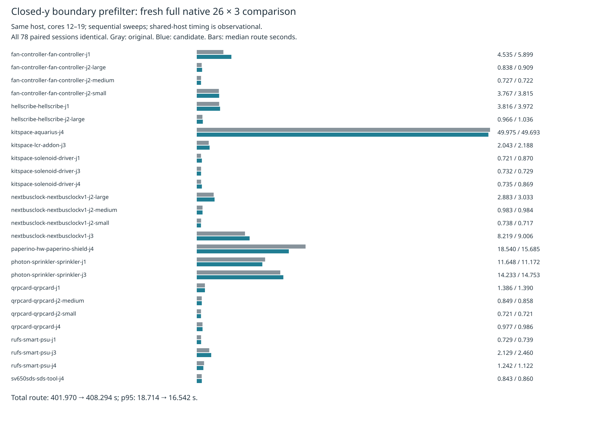

# Closed-y boundary prefilter: full native negative result

The previous one-board replay suggested a saving in boundary containment. This cycle tested the exact same one-line candidate on fresh complete native sweeps. **Do not adopt:** total route pipeline seconds increased 1.57%, overall attempt median increased 1.99%, and measured sweep wall increased 2.29%. Overall p95 improved 11.60%, but the full speed result does not meet the nonregression gate. Timing is observational on a shared host; this does not prove causal overhead attribution.

Production source, defaults and consumer pin remain unchanged. The candidate skips an edge only when the probe y lies strictly outside its closed y interval, before the existing exact boundary predicate. The earlier `../ring-prefilter/` archive retains the predicate parity probes, one-board replays and profile context. This archive supersedes their provisional speed implication with a full native measurement.

Both versions enable the existing optional local recovery through identical wrappers. The frozen 26 cases, three seeds, deterministic shuffled order, source inputs, configuration, runtime, checker, and cores 12–19 agree. Runs were sequential, original then candidate, nice 10, 3,000-second outer limit per sweep and unchanged 3,600-second harness attempt limit. No own heavy jobs overlap either sweep. Both supervisors exit zero, every attempt finishes/checks without timeout, and controls report complete/preserved. Other host activity is uncontrolled.

| Metric, 26 cases × 3 repeats | Original | Candidate |
|---|---:|---:|
| Passed attempts / 78 | 48 | 48 |
| Valid cases, 3/3 | 16 | 16 |
| Opens, sum | 90 | 90 |
| Native errors relative to input baseline, sum | 27 | 27 |
| Candidate-introduced findings relative to control | — | 0 |
| Overall median route pipeline seconds | 1.102839 | 1.124751 |
| Overall p95 route pipeline seconds | 18.713538 | 16.542386 |
| Sum route pipeline seconds | 401.970226 | 408.293589 |
| Sum per-case medians, seconds | 134.975054 | 135.188938 |
| Sum per-case p95, seconds | 139.057049 | 143.573965 |
| Measured sweep wall, seconds | 511.513579 | 523.250715 |
| Outer command wall including preflight/report, seconds | 521.408926 | 533.992713 |
| Vias, sum | 2826 | 2826 |
| Track length, sum mm | 60450.378202 | 60450.378202 |

All **78/78 paired session bytes** agree. Every pair has equal effective settings, input DSN, manifest and candidate settings, and no added native error or warning geometry. Error comparison preserves multiplicity; warning geometry omits generated UUIDs. Existing 27 native thermal errors remain unresolved, so this is not a clean-native-board claim. Per-case medians/p95, passes, opens and errors appear in [table.md](table.md); vias/length also appear in `summary.json`. Overall p95 is nearest-rank over 78 attempts; per-case p95 is the maximum of three repeats. Failed boards remain included in descriptive timing statistics.

Larger dense/ladder inputs and slow acceptance were not rerun: this candidate already failed the primary speed gate and is rejected rather than promoted. They remain required for a future candidate that passes this gate. No consumer pin bump is warranted.



`raw-attempts.json.gz` retains losslessly encoded raw checker/record files, exported DSN/session, settings, manifest and router reports for all 156 attempts, with per-file SHA256. Separate raw result/summary/control archives, supervisor statuses and logs bind the complete runs. `full-source-audit.json.gz` binds all 1,550 tracked implementation/specification/test/tool/wrapper files; `source-audit.json.gz` also binds the earlier original/candidate source/spec preparation; only `src/geom/predicates.ts` differs. `input-provenance.json.gz` preserves case licenses and metadata inherited from the same frozen suite. The source preparation replay matches all measured source hashes and wrapper bytes.

`verify.py` reconstructs both output trees in `/tmp`, checks file digests and raw-check/result consistency, then replays `compare.py` and requires exact equality with the committed comparison. Four deliberate corruptions must fail. The first verifier attempt exposed that raw checker files were not cross-checked with the checker copy in results; that gap was fixed before final verification. No measurements were rerun or discarded. The chart was visually inspected.

Reproduce from this repository root; `bench` must point to an already prepared standalone benchmark checkout with the frozen native runtime. The work directories must be unused:

```sh
asset=docs/pr-assets/agent-fab-router-perf-local-rescue/ring-native
work=/tmp/boundary-native-reproduction
bench=/path/to/fab_pcb
mkdir "$work"
python3 "$asset/prepare.py" "$work/source"
python3 "$asset/run.py" "$work" "$bench"
python3 "$asset/compare.py" "$work/native-original" "$work/native-candidate" "$work/comparison.json"
python3 "$asset/report.py" "$work/comparison.json" "$work/report"
rsvg-convert -w 1600 "$work/report/timings.svg" -o "$work/report/timings.png"
python3 "$asset/checks.py" "$work" "$PWD"
python3 "$asset/verify.py"
```

The final command independently verifies the committed archive; fresh run comparison/report commands use the fresh output. `checks.py` runs typecheck, layer checks and the full test suite sequentially on candidate and production under cores/nice/timeouts. Both candidate and production pass typecheck, 71 layer files / zero violations, and all 912 tests / zero failures / 399,733 assertions. Candidate tests take 335.45 seconds; production tests take 338.91 seconds. The check supervisor exits zero. Raw check logs and stage exits are archived. No frozen checker, scoring, board, rule, source test or routing implementation was modified.
