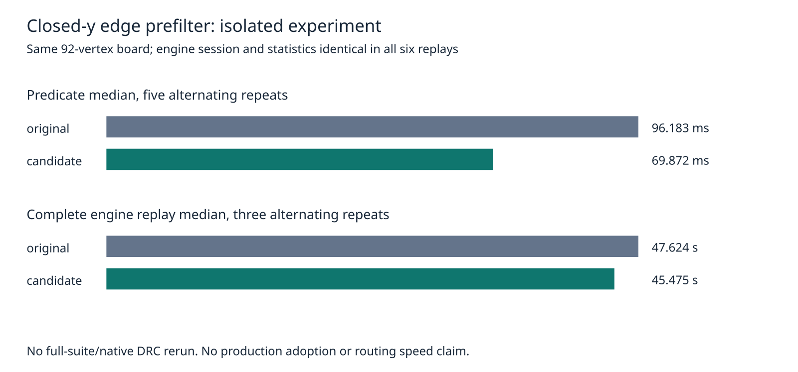

# Closed-y edge prefilter prerequisite

This isolated candidate skips a ring edge before `onSeg` only when the probe is strictly outside the edge's closed y interval. Production sources, recovery defaults, board rules and the consumer pin remain unchanged. This is a prerequisite for a future full-suite optimization experiment, not a routing performance or native safety claim.

For finite board coordinates, an edge outside that interval cannot contain the probe and cannot straddle its y coordinate. Consequently neither the original boundary return nor the crossing toggle can happen. Equality remains eligible: horizontal edges, repeated vertices, zero-length edges and exact vertex hits still use the original predicates. Rings shorter than three points retain their existing implementation. There is no cache, prepared state or invalidation assumption; every call reads current coordinates.

`probe.ts` checks 630,816 original/candidate classifications: the actual 92-vertex outline, reversed winding, deterministic random probes, vertices and edge midpoints at y offsets -1/0/+1, plus 3,000 generated rings including degeneracy and live vertex mutation. Synthetic probes are not a capture of production routing queries. Timings use one warmup and five alternating repeats, three passes of 100,552 probes each. `results.json` contains every raw timing and classification checksum.

`prepare.py` makes isolated tracked source snapshots from the current branch and changes exactly one line in the candidate's `src/geom/predicates.ts`. `source-audit.json.gz` binds all tracked source/spec bytes in both snapshots. No production patch is adopted. `run.py` runs three alternating pairs on the previous profile's complete exported board and settings, with cores 12–19, nice 10, and 240 seconds per attempt. No heavy jobs of this agent overlap those timings; other host workloads remain uncontrolled. Each complete replay must match the independent prior production control in session hash, input, settings, final statistics and entire report except wall-clock time. All recovery log structure must also agree across the six attempts after removing only nested `seconds` timing fields; raw logs are retained.

`replays.json.gz` retains all six complete results. `verify.py` independently repeats those comparisons and rejects corrupted session, settings, statistics, report and recovery logs. The earlier independent control and licensed input remain in sibling `native-profile/`. No fresh native checker, 26×3 suite, dense board, ladder or slow acceptance run was completed here; known native thermal errors are unresolved. All such measurements remain required before adopting the engine change. No native score is added to the shared history for these replay diagnostics.

Same host and cores, alternating paired order; maximum is reported rather than estimating a tail percentile from three attempts.

| Scope | Repeats/source | Original median / max | Candidate median / max |
|---|---:|---:|---:|
| Isolated predicate | 5 | 0.096183 / 0.097530 s | 0.069872 / 0.070963 s |
| Complete engine replay | 3 | 47.624167 / 49.080098 s | 45.475110 / 47.734953 s |

The complete-engine median is 4.5% lower in this one-board observation; the candidate has not passed the required full native benchmark. Engine residuals remain eight, exact violations remain zero, and native historical 15 opens / six thermal errors are not rechecked. Copper, vias and length are identical because sessions and statistics match exactly. Production required checks pass: typecheck, 71 layer files / zero violations, 912 tests / zero failures / 399,733 assertions. The isolated candidate passes typecheck, layer checks and 19 existing geometry/performance tests / 253,603 assertions; this is not a candidate full-suite test run.

The initial supervisor completed all six attempts, then exited 1 because its final assertion compared raw logs containing elapsed seconds. `supervisor.log.gz` retains that failure. No routing attempt failed or timed out. The corrected public verifier independently validates every saved attempt after excluding only those timing fields, including five deliberate corruption controls; no result was rerouted or discarded. Public snapshot preparation was replayed and its entire source audit matches the original measurement preparation byte-for-byte.



Exact reproduction from the repository root (output directory must not exist):

```sh
asset=docs/pr-assets/agent-fab-router-perf-local-rescue/ring-prefilter
work=/tmp/ring-prefilter-reproduction
python3 "$asset/prepare.py" "$work"
taskset -c 12-19 nice -n 10 timeout 120 bun "$asset/probe.ts" "$work/probe.json"
PYTHONDONTWRITEBYTECODE=1 python3 "$asset/run.py" "$work"
python3 "$asset/verify.py"
python3 "$asset/plot.py"
rsvg-convert -w 1600 "$asset/timing.svg" -o /tmp/ring-prefilter.png
bun run typecheck && bun run check:layers && bun run test
```

The archived verifier consumes the committed results; fresh results are in `$work`. Timings are observational and will vary. The chart compares medians with separate axes for predicate milliseconds and complete-engine seconds.
