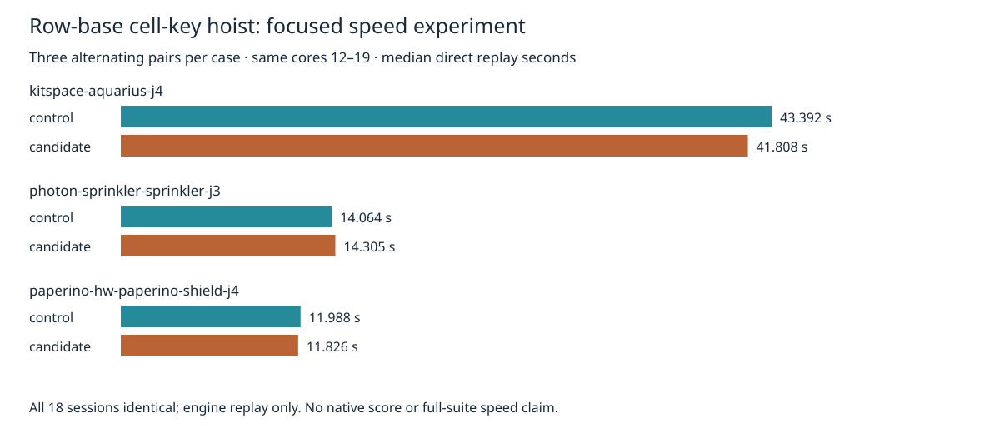

# Rejected row-base cell-key experiment

The isolated candidate hoists `(cx + KEY_OFFSET) * KEY_STRIDE` from the inner cell loop to once per occupied query row. It retains the original `rowKey + (cy + KEY_OFFSET)` arithmetic grouping, numeric keys, bucket traversal, slot stamps, filter callback order and sorted output. Only `src/lattice/grid.ts` differs. This experiment adds no cache and changes no physical rules or settings. Production source/tests remain unchanged.

Three fresh alternating pairs per case (control/candidate, candidate/control, control/candidate), same hyper-ms-lin host, cores 12–19, nice 10, timeout 180 seconds per process. Frozen seed-1 DSN/settings: 100 passes, optimizer enabled, recovery unset. Sequential cases/processes, no own heavy checks overlap. Nearest-rank p95 is the maximum of only three repeats; shared-host observations do not prove causal differences.

| Case | Control median / p95 s | Candidate median / p95 s | Median change |
|---|---:|---:|---:|
| kitspace-aquarius-j4 | 43.392190 / 44.303524 | 41.808457 / 42.370310 | -3.65% |
| photon-sprinkler-sprinkler-j3 | 14.064435 / 14.082129 | 14.305335 / 15.271797 | +1.71% |
| paperino-hw-paperino-shield-j4 | 11.987597 / 13.053559 | 11.826479 / 13.056729 | -1.34% |

Sum of nine route durations: 208.534157435 → 204.896540259 seconds (-1.74%). Despite lower aggregate time and Aquarius median, the sprinkler median and p95 are adverse. Candidate rejected at focused speed gate. No speed improvement adopted, no universal claim about arithmetic hoisting or JIT behavior.

All 18 complete sessions byte-identical to the immutable adjacent references. Full settings/results/statistics/diagnostics match removing ONLY result.report.wallClockMs. Engine incomplete connections remain 8/2/6 and added represented-rule violations remain zero for Aquarius/sprinkler/shield respectively. These are engine replay counts, NOT native scoring. No fresh native/full26×3/dense/ladder/slow acceptance run; the candidate is rejected before adoption. Known native thermal errors and adverse L3 tail remain unresolved; recovery remains default off. No attempts failed, timed out or were omitted.



The adjacent `default-slow-profile` package holds immutable complete base source archive, inputs, licenses and provenance. `source-audit.json` records all 1,488 source/spec hashes per version. `candidate-grid.ts.gz` contains the exact candidate. `prepare.py` reconstructs the one replacement with an exact single-match guard; `reproduce.py` checks base source and input hashes before each routing process. All raw sessions, full reports, durations and process logs are retained. `verify.py` checks each attempt against complete immutable references and recomputes summaries. Corruption controls reject changed sessions, reports, candidate source and missing runs even when their manifest hashes are updated.

Reproduce from repository root with installed Bun, Python and rsvg-convert; use a new output directory:

```bash
ASSET="$PWD/docs/pr-assets/agent-fab-router-perf-local-rescue/row-key"
PYTHONDONTWRITEBYTECODE=1 python3 "$ASSET/reproduce.py" /tmp/row-key-new
PYTHONDONTWRITEBYTECODE=1 python3 "$ASSET/verify.py"
PYTHONDONTWRITEBYTECODE=1 python3 "$ASSET/test-verify.py"
python3 "$ASSET/plot.py"
taskset -c 12-19 nice -n 10 timeout --kill-after=10 1800 bash -c 'bun run typecheck && bun run check:layers && bun run test'
```

`--prepare-only` reconstructs both versions and runs 61,078 stateful differential checks plus 100,000 exact numeric-key comparisons without routing. Differential coverage includes replacement/removal/slot reuse/rebuild, ownership of returned arrays/ref objects, mutable filters and callback ordering, sheet/mode/diagonal differences and numeric edge cases. Candidate typecheck passes. Candidate full suite is not run after rejection; final production repository checks are retained separately in checks.log.gz.

Initial source identity audit attempted ignored acceptance output then Git-quoted Unicode paths; both failed before claiming validation. Corrected NUL-delimited tracked-file audit verifies all 1,488 source/spec files against the control. No benchmark attempt was rerun or dropped.

Final required repository checks: typecheck PASS; 71 layer files / zero violations; 914 tests / zero failures / 649747 assertions in 316.61 seconds. Independent archive reconstruction matches all source/spec hashes and passes both comparison scripts. Chart PNG visually inspected.
