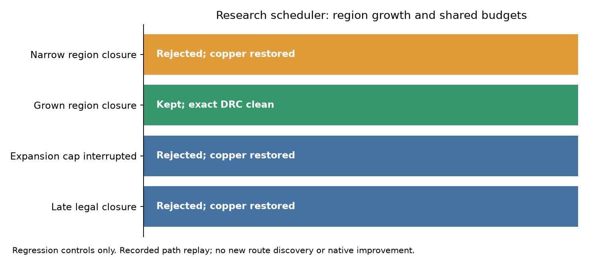

# Gradual research recovery scheduler — cycle 28

The explicit-opt-in research scheduler constructs pad-centre endpoint boxes padded
by a strictly increasing sequence of lattice-pitch multiples. It retries proposals
only after the transaction gate has rejected and rewound the previous proposal.
Every attempt uses the ownership, local final-copper-delta, exact DRC, terminal
preservation and target-closure checks. It stops after a retained closure, attempt
cap, shared expansion cap, or cooperative monotonic deadline. Disabled scheduling
never calls the proposal. Already joined pad endpoints are skipped. Invalid plans,
non-pad targets and overflowing regions throw before proposals start.

Search callbacks must call `expand()` **before each search expansion**. The cap is
shared across retries, not reset on region growth. Deadline checks occur before
and after the callback and at expansion checkpoints. A late proposal is rewound
before exact acceptance checks. This does not preempt a synchronous callback, bound
DRC/connectivity validation time, count uncharged work, or sandbox direct mutations.
Callbacks remain trusted, synchronous, Journal-only and rule preserving. The copied
callback region cannot enlarge the transaction's acceptance region.

Three fresh normal-pipeline repeats of the real ten-pad reduced fixture reject the
recorded legal witness in the endpoint-only box, then keep it in a grown box with
zero target opens and zero exact violations; explicit cleanup restores the session.
This is **recorded path replay**, not new route discovery. The original physical
board is not solved. No production settings, search, safety margins or rules change.

| Same reduced fixture, three repeats, same host/cores 12–19 | Prior caller-supplied region | Scheduled endpoint regions |
| --- | --- | --- |
| Full-width recorded legal path | kept 3/3 in explicit fitting box | narrow rejected, grown kept 3/3 |
| Target opens after retained proposal | 0 | 0 |
| Exact violations | 0 | 0 |
| New path finding / original-board closure | not demonstrated | not demonstrated |



Four synthetic scheduler tests pass 77 assertions: region growth and callback-box
isolation; shared expansion exhaustion after partial insertion; attempt cap,
opt-out, invalid inputs and exception rollback; late legal closure rollback using
a controlled monotonic clock. Deliberately disabling each expansion cap, attempt
cap, deadline check and region copy fails the corresponding regression. These are
sensitivity checks of new research code, not historical engine defects.
[Captured logs and source hashes](schedule-checks/results.json).

The existing real-fixture transaction regression now passes 300 assertions. Its
five gate bypasses still fail. The no-rewind mutation now fails earlier: the first
narrow rejected closure stays connected and the next retry correctly throws
`Recovery target is already joined`. The initial runner expected the older session
assertion diagnostic; its failed invocation is retained in cycle scratch. Only the
expected diagnostic was updated; no routing measurement was discarded.

Reproduce from the router checkout using unused paths:

```sh
python3 docs/pr-assets/agent-fab-router-perf-local-rescue/validate-recovery-schedule.py \
  "$PWD" /tmp/recovery-schedule-new
python3 docs/pr-assets/agent-fab-router-perf-local-rescue/validate-recovery-transaction.py \
  "$PWD" /tmp/recovery-schedule-gates-new
taskset -c 12-19 nice -n 10 timeout 900 bash -c \
  'bun run typecheck && bun run check:layers && bun run test'
```

Original-board proposal search, connection collection, production post-pass
integration, native-safe recovery and candidate dense6/L2/L3/slow validation remain
pending. Existing exact DRC is not a native refill safety proof. No speed gain,
completion improvement or downstream pin bump is claimed. Older reports describe
the helper versions captured in those cycles; this report supersedes statements
that endpoint construction and cooperative retry budgets are wholly absent.

Required checks pass: typecheck, layer validation (65 files / zero violations), 866 tests / 398899 assertions.

Full unchanged-production native verification: same 26 cases × 3 repeats, host and cores 12–19, compared with cycle 27. All 78 sessions, pass outcomes, opens, new errors, vias and lengths match exactly. Production source, inputs, settings, runtime, checker and execution order match.

| Native metric | Prior control | Current unchanged production |
| --- | ---: | ---: |
| Passed / valid 3-of-3 cases | 39/78 / 13/26 | 39/78 / 13/26 |
| Opens | 120 | 120 |
| New native errors | 27 | 27 |
| Attempt median / p95 seconds | 1.105 / 16.325 | 1.118 / 20.329 |
| Total route seconds | 387.039 | 393.773 |

The 27 existing thermal errors remain unresolved: **not native DRC clean**. Shared-host timings overlap tests; no speed gain claimed. [Per-case median/p95, quality, vias and length](https://github.com/fabPlane/fab_router/blob/agent/fab-router-perf-local-rescue/docs/pr-assets/agent-fab-router-perf-local-rescue/schedule-checks/native-tables.md).
