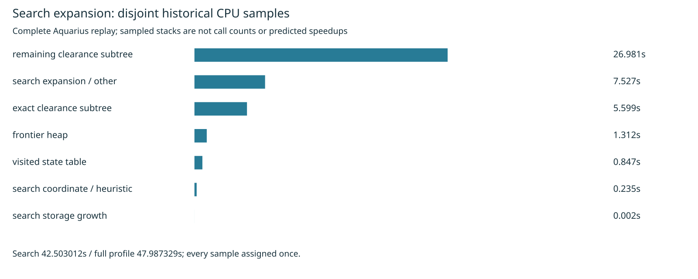

# Disjoint search-state profile

Cycle71 partitions the existing cycle56 complete Aquarius J4 profile. No routing rerun, source change, setting change, rule change or consumer pin update is made. The latest full native comparison remains cycle70 in [segment-native](../segment-native/README.md); that candidate remains parked after mixed timing. This analysis claims no improvement or new native quality result.

The analyzer recognizes source-qualified `aStar` and `aStarLayered` ancestors. Within each search sample it gives clearance precedence, splitting exact `hitBlocks` descendants from remaining clearance descendants. Outside clearance it assigns the nearest recognized heap, visited-table or coordinate operation; growth and an explicit remainder complete the partition. It also retains separate nearest-search caller, recovery phase and self-leaf tables. Every sample is counted once, without adding inclusive parent and child time.

| Disjoint search group | Sampled seconds | Search share |
|---|---:|---:|
| remaining clearance subtree | 26.980502 | 63.48% |
| search expansion / other | 7.527000 | 17.71% |
| exact clearance subtree | 5.598791 | 13.17% |
| frontier heap | 1.311920 | 3.09% |
| visited state table | 0.847158 | 1.99% |
| search coordinate / heuristic | 0.235457 | 0.55% |
| search storage growth | 0.002184 | 0.01% |

All 44,928 samples / 47.987329 seconds reconcile: 42.503012 under search, 5.484317 outside. Search clearance contributes 32.579293 seconds. Frontier heap contributes 1.311920 seconds (2.73% of the complete sampled profile), visited state 0.847158 (1.77%). These observed shares are not a speedup bound: inlining, sampling and attribution can hide work in callers. The 7.527000-second remainder includes expansion callbacks and descendants, rather than measuring loop overhead alone. Remaining clearance includes outline containment, lattice queries and sweep setup, so its large share does not identify a new untested optimization. Prior boundary/lattice/segment candidates already have adverse or mixed measurements.

Source inspection identifies a distinct candidate: replace repeated four-array swaps in `SoaHeap.pop` with a hole-based sift that moves a chosen child upward and writes the saved last tuple once. Preserve the exact `(f,h,seq)` order, left/right tie choice, popped fields, state values, empty/singleton behavior and pooled reset/growth behavior. This is only a hypothesis, not implemented or adopted here. Before timing, compare complete pop sequences against the unchanged heap across equal priorities, mixed insertion/removal, capacity growth and reset. Instrument complete-board heap operations if needed; samples do not provide operation counts or memory-write counts. Require complete-board session/statistics parity and alternating engine timings before a fresh full 26x3 native comparison. Adoption additionally needs dense6, ladder L2/L3, enabled slow acceptance and required checks; do not infer speed from an isolated heap microbenchmark.

Seven malformed-profile controls reject duplicate nodes, unknown samples, cycles, unknown children, mismatched duration counts and negative/nonfinite durations. Hand-counted synthetic stacks verify clearance precedence over a nested recognized search helper, qualified names, caller separation, remainder and recovery phase. Independent replay reproduced summary, table and SVG byte for byte. A separate root-down traversal in `verify.py` confirms search membership and checks that search exact-clearance samples are a subset of the earlier independent whole-profile exact-clearance partition. The source compressed SHA-256 is recorded in the summary. The rendered PNG was visually inspected.

Reproduce into an unused directory:

```sh
asset=docs/pr-assets/agent-fab-router-perf-local-rescue/search-profile
python3 "$asset/verify.py" /tmp/search-profile-verified
python3 "$asset/analyze.py" /tmp/search-profile-replay
cmp "$asset/summary.json" /tmp/search-profile-replay/summary.json
cmp "$asset/table.md" /tmp/search-profile-replay/table.md
cmp "$asset/profile.svg" /tmp/search-profile-replay/profile.svg
rsvg-convert -w 1600 /tmp/search-profile-replay/profile.svg -o /tmp/search-profile-replay/profile.png
taskset -c 12-19 nice -n 10 timeout 900 bash -c 'bun run typecheck && bun run check:layers && bun run test'
```

No scored benchmark completed this cycle, so no history row is fabricated. The known 27 native thermal errors remain unresolved and separately owned; engine exact checks do not establish native safety. Full native, stress and slow acceptance were not rerun for this diagnostic.



Required checks passed: typecheck, 71 layer-checked files / zero violations, 912 tests / zero failures / 399733 assertions (343.58 seconds). Supervisor exit 0. Full log retained in `checks.log.gz`.
