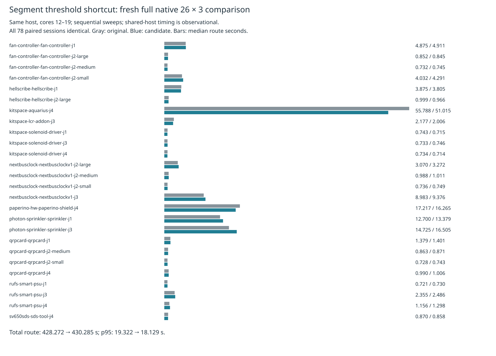

# Segment threshold shortcut: fresh full native comparison

This measures the exact isolated candidate from
[the complete-board prerequisite](../segment-shortcut/README.md). Only
`src/route/clear.ts` differs. It retains core/radius construction, tests
intersection first, then short-circuits ordered endpoint-distance comparisons,
with the original computation as a fallback outside the finite coordinate domain.
Production source, defaults and the consumer pin remain unchanged. Existing
local recovery is enabled identically through the same wrapper in both sources.

The single-board prerequisite was unfavorable: all three candidate replays were
slower, with median 54.899422 → 56.357422 seconds. This separate fresh comparison
runs every frozen case three times on the same machine, cores 12–19, original
then candidate. No own heavy checks overlap either measured sweep. Shared-host
sequential observations do not establish a causal allocation/JIT explanation or
reliable speed nonregression. No routing attempt is discarded or rerun.

**Parked:** aggregate median falls 0.55% and p95 falls 6.17%, while total route time rises 0.47% and summed case p95 rises 2.20%. 17 case medians and 16 case p95s worsen. All three complete-board prerequisite pairs are slower. This does not establish reliable speed nonregression; the candidate is not adopted. Dense input, ladder L2/L3 and enabled slow acceptance were not rerun after this unfavorable speed gate. There is no consumer pin bump.

Both sweeps complete all 78 attempts with preserved controls, no interruption and supervisor exit 0. All 78 paired sessions and final engine statistics are identical. Native finding geometry/multiplicity, warning geometry, effective settings and fidelity show zero regression. Both have 48/78 passed, 16/26 valid cases, 90 opens and 27 known thermal errors. Those errors remain unresolved.

| Full native metric (26 cases × 3 repeats) | Original | Segment shortcut |
|---|---:|---:|
| Passed / 78 | 48 | 48 |
| Valid cases / 26 | 16 | 16 |
| Opens | 90 | 90 |
| New native errors (known, unresolved) | 27 | 27 |
| Median route seconds | 1.142428 | 1.136153 |
| p95 route seconds | 19.322247 | 18.129336 |
| Sum route seconds | 428.272124 | 430.285116 |
| Sweep wall seconds | 541.338493 | 542.988088 |
| Sum case medians seconds | 143.022240 | 140.710285 |
| Sum case p95 seconds | 152.286739 | 155.643413 |
| Sum vias | 2826 | 2826 |
| Sum length mm | 60450.378202 | 60450.378202 |

The aggregate results are in [aggregate-table.md](aggregate-table.md), and all
26 case medians/p95s, pass/open/error counts are in [table.md](table.md). The
nearest-rank p95 is the maximum of three repeats per case and order statistic 75
of 78 for the aggregate. Copper metrics are sums across all repeats.



The archive retains all 156 raw checks, step records, DSNs, sessions, settings,
manifests and engine reports, plus complete benchmark controls/results/summaries,
logs, source hashes, supervisor exits, input licenses and job provenance. The
source audit covers implementation/specification/test/tools/config/wrapper bytes.
Original implementation hashes also match the independent archived workload.
All source, settings, native findings, warning geometry, fidelity, statistics and
session comparisons are checked by the independent archive reconstruction.
Existing native thermal findings remain unresolved; this is not a DRC-clean
claim. A shortcut cannot repair those findings.

Sweep wall time uses the benchmark UTC start/end controls; supervisor wall
time includes final report generation.

Both isolated sources and the production checkout pass typecheck, layer checks
(71 files, zero violations), and 912 tests / 399,733 assertions. API-level
finite equivalence and an equality-boundary mutation are documented in the
prerequisite. Existing rules and tests are unchanged.

Exact reproduction from this repository root with installed native dependencies
and the benchmark worktree's private runtime, using an unused scratch directory:

```sh
p=docs/pr-assets/agent-fab-router-perf-local-rescue/segment-shortcut
n=docs/pr-assets/agent-fab-router-perf-local-rescue/segment-native
s=/home/hyper/bench/agents/codex-fabpcb-perf/scratch/segment-native-reproduction
python3 "$p/prepare.py" "$s/work"
python3 "$p/run.py" "$s"
taskset -c 12-19 nice -n 10 timeout 900 bash -c 'bun run typecheck && bun run check:layers && bun run test'
for mode in original candidate; do
  python3 "$p/native-run.py" "$s/work" "$HOME/bench/wt/fp-perf" "$mode"
done
python3 "$n/compare.py" "$s/work/native-original" "$s/work/native-candidate" "$s/work/comparison.json"
python3 "$n/report.py" "$s/work/comparison.json" "$s/report"
python3 "$n/aggregate.py" "$s/report"
rsvg-convert -w 1600 "$s/report/timings.svg" -o "$s/report/timings.png"
```

Each sweep invokes this exact command from the benchmark worktree:

```sh
taskset -c 12-19 nice -n 10 timeout 3000 python3 benchmarks/autorouter/benchmark.py --router fab-router --fab-router-source SOURCE/entry --out OUTPUT
```

The wrapper only sets `localRecovery:true`. Frozen inputs, checker, scoring,
per-case settings and shared baseline runtime are unchanged.

Verify the committed archive without routing or native tools:

```sh
n=docs/pr-assets/agent-fab-router-perf-local-rescue/segment-native
PYTHONDONTWRITEBYTECODE=1 python3 "$n/verify.py"
python3 "$n/report.py" "$n/comparison.json" /tmp/segment-native-report
python3 "$n/aggregate.py" /tmp/segment-native-report
```

The verifier rejects missing-repeat, changed-session, added-native-finding and
changed-effective-setting controls. The prerequisite archive separately checks
nine source/record corruptions. Any adoption would also require convincing
speed results and the dense input, ladder L2/L3 and enabled slow acceptance gates.
