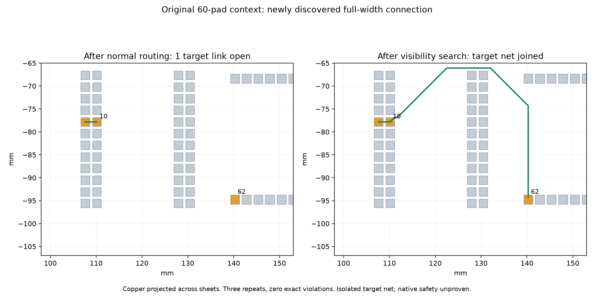

# Bounded visibility proposal experiment — cycle 29

A new research-only proposal search discovers a legal full-width path in the
original 60-pad stall context. It does not load the recorded path. Normal routing
first connects the short 9→10 branch and leaves 10→62 open. The runner collects
that actual incomplete pad pair, then schedules growing endpoint regions with
one shared cooperative work cap and deadline. The proposal graph uses pad-centre
endpoints and expanded foreign-pad bounding-box corners on common permitted
sheets. Directed graph edges use existing exact angle shaping and full-width
clearance checks. Dijkstra reconstruction preserves each accepted edge's shaped
vertices instead of reshaping the complete polyline. Full copper must fit the
local region. Only a final candidate is inserted through the Journal; the existing
transaction independently validates exact DRC, connected terminals, retained
copper, region containment and target closure before keeping it.

This is an opt-in research command, not a production setting. No production file,
rule, clearance, track width, via form or default changes. The graph is incomplete:
it has no via transitions, rip-up, pad-edge attachment, track/pour-derived nodes,
necking or local legalisation. The corner offset is a proposal heuristic; exact
geometry always decides. At most 512 nodes per sheet; candidate generation,
settled-node selection and directed-edge checks each charge one shared work unit.
The budget therefore conservatively counts more than search-node expansions.
Callbacks remain cooperative and trusted; validation time is outside the deadline.

Both contexts use the same input/settings/host/cores 12–19, three repeats each.
The original context retains **all 60 pads** as obstacles but routes only one net;
the reduced context retains ten pads. These are engine-only target-net experiments,
not full physical-board or native DRC scores. All repeats produce the same final
session per context. The short existing branch, retained geometry and live index
survive; explicit cleanup restores the exact pre-search session.

| Context, three repeats | Normal routing | Normal + visibility proposal |
| --- | ---: | ---: |
| Ten-pad target opens per repeat | 1 | 0 |
| Original 60-pad target opens per repeat | 1 | 0 |
| Exact violations, both contexts | 0 | 0 |
| Ten-pad routed length mm | 2.540 | 39.780 |
| Original routed length mm | 2.540 | 60.878 |
| Vias, both contexts | 0 | 0 |
| Closures retained | none | 3/3 per context |

The reduced graph closes at margin 4 pitches after the endpoint-only box misses;
the original graph misses at 0/4/8 pitches and closes at 16. Charged work is
568 and 32038 respectively. This is additional recovery work, not a speed gain.
Final captured normal / added recovery median seconds are 3.294 / 0.005716
for the reduced context and 3.346 / 0.105678 for the original. With three repeats,
p95 is the maximum: normal / recovery 4.306 / 0.006126 and 3.376 / 0.124969.
Shared-host timings overlap tests and the native sweep; no isolated timing claim.
Captured route/recovery timings, paths, boxes and before/after session hashes are
in [measurements](visibility-checks/measurements.json). Earlier exploratory batches
are retained in cycle scratch and separately logged; all corresponding session
hashes match. The first image attempt found missing sheet-zero bounds on back-sheet
pads; the final runner captures per-sheet bounds and frame scale, and the plot uses
the new route's sheet. No routing measurement was discarded.



Three new regression tests cover deterministic obstacle detours after region
growth, budget exhaustion and bounded-graph misses without state leaks, and three
normal-pipeline original-context closures without importing a witness. Two deliberate
mutations independently remove corner generation and budget charging; each fails
the intended regression. [Captured controls and hashes](visibility-checks/results.json).
An initial synthetic fixture used non-enforced obstacle rules; it was corrected to
positive clearance before capturing final tests. No production rules were weakened.

Reproduce from the router checkout with unused outputs:

```sh
taskset -c 12-19 nice -n 10 timeout 300 bun \
  docs/pr-assets/agent-fab-router-perf-local-rescue/run-visibility.ts /tmp/visibility-new.json
python3 docs/pr-assets/agent-fab-router-perf-local-rescue/validate-visibility.py \
  "$PWD" /tmp/visibility-controls-new
python3 docs/pr-assets/agent-fab-router-perf-local-rescue/plot-visibility.py \
  /tmp/visibility-new.json /tmp/visibility-new.png
taskset -c 12-19 nice -n 10 timeout 900 bash -c \
  'bun run typecheck && bun run check:layers && bun run test'
```

Full candidate native comparison, dense6, ladder L2/L3 and slow acceptance remain
required before production adoption. Exact engine DRC does not prove native refill
safety. Existing thermal errors are unresolved. No downstream pin bump is justified.

Required checks: typecheck, layer validation (65 files / zero violations), 869 tests / 398965 assertions.

Full unchanged-production native verification: same 26 cases × 3 repeats, host and cores 12–19, compared with cycle 28. All 78 sessions, pass outcomes, opens, new errors, vias and lengths match exactly. All 91 production source files, inputs, settings, runtime, checker and execution order match. This sweep does not invoke the research proposal and is not evidence of native safety for its new copper.

| Native metric | Prior control | Current unchanged production |
| --- | ---: | ---: |
| Passed / valid 3-of-3 cases | 39/78 / 13/26 | 39/78 / 13/26 |
| Opens | 120 | 120 |
| New native errors | 27 | 27 |
| Attempt median / p95 seconds | 1.118 / 20.329 | 1.109 / 16.532 |
| Total route seconds | 393.773 | 383.787 |

The 27 existing thermal errors remain unresolved: **not native DRC clean**. Shared-host timings overlap tests; no speed gain claimed. [Per-case median/p95, quality, vias and length](https://github.com/fabPlane/fab_router/blob/agent/fab-router-perf-local-rescue/docs/pr-assets/agent-fab-router-perf-local-rescue/visibility-checks/native-tables.md).
