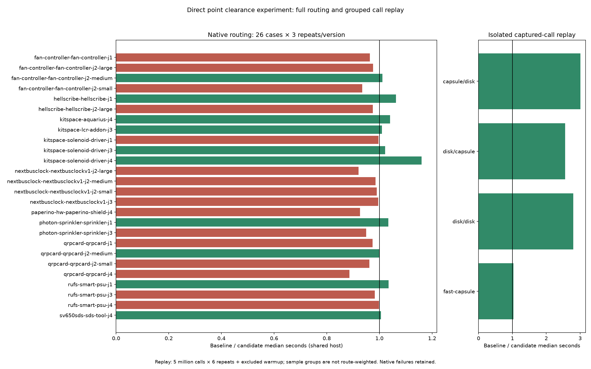

# Direct point clearance experiment — rejected

The candidate bypassed temporary convex-core arrays for disk/disk and disk/capsule comparisons in `closerConvex`, using the existing point-distance predicates. Production code is restored to main `69cf598`: the final change retains the differential test, reproducible tools, exact rejected patch and measurements. Candidate `98a3943` remains available in branch history. This experiment does not build on the separate capsule/capsule PR.

The isolated public-call replay is faster, but native aggregate medians show no improvement, native Paperino is 7.9% slower, fixed-pass L2 is 3.9% slower and profiled Paperino is 4.3% slower. Shared-host timings do not establish causal slowdown; they do not justify adopting this candidate as a routing optimization. No shipped speedup is claimed.

## Measurements on hyper-ms-lin

All before/after comparisons use the same cases and machine, Bun 1.4.0 and assigned cores 12–19. Own tests, replay, native, ladder and profiles run sequentially; light analysis/TypeScript work overlaps routing. Other host workloads are uncontrolled. Direct jobs and native workers have observed nice 15. No configurations, checker, scoring or frozen inputs were changed.

| Workload | Repeats/version | Before median s | Candidate median s | Result |
|---|---:|---:|---:|---|
| Native sum of case medians, all 26 cases | 3/case | 128.341 | 128.859 | 0.4% higher |
| Native Paperino | 3 | 16.266 | 17.555 | 7.9% higher |
| Fixed two-pass L1 | 3 | 0.143242 | 0.147504 | 3.0% higher |
| Fixed two-pass L2 | 3 | 18.196761 | 18.899950 | 3.9% higher |
| CPU-profiled Paperino | 3 | 15.922932 | 16.603394 | 4.3% higher |
| Replay capsule/disk, 5 million calls | 6 + excluded warmup | 0.185139 | 0.061564 | 66.7% lower |
| Replay disk/capsule, 5 million calls | 6 + excluded warmup | 0.167488 | 0.065445 | 60.9% lower |
| Replay disk/disk, 5 million calls | 6 + excluded warmup | 0.142826 | 0.051077 | 64.2% lower |
| Replay fast-capsule, 5 million calls | 6 + excluded warmup | 0.287288 | 0.278263 | 3.1% lower |

Native totals across all 78 attempts: **389.496 → 384.824 seconds**. The total and sum of medians differ in direction; neither supports a broad routing speedup claim. Both versions: **39/78 passes, 13/26 cases passing 3/3, 120 opens, 27 existing native errors**. These fixtures are not a DRC-clean suite. All 78 paired SES hashes, pass/open/error types/fidelity outcomes, vias and lengths are identical. The analyzer verifies source/config/runtime/checker identities and invocation chronology. Full per-case median/p95 table follows below; p95 uses the nearest-rank maximum of three repeats and is not a stable tail estimate.

All 12 ladder sessions are identical, with no timeout/abort. L1 completes; L2 retains 29 incomplete connections and zero added router violations. Router counters are not native DRC. Unsuffixed L1/L2 inputs match the board agent directory; newer revisions, L3 and BGA boards are outside this experiment. No fresh slow acceptance was run: the production candidate was rejected at the performance gate, before adoption. Prior slow failures remain unresolved; this is not a candidate slow-acceptance pass.



## Profile and correctness findings

Each of six separate CPU-profiled processes emits the same session as native Paperino, with identical settings/input hashes and no timeout/abort. Baseline/candidate CPU sample totals: 46,185 / 46,681. `coreOf` self samples decrease 1,122 → 934 and `dist2Pts` 143 → 40; `dist2SegSeg` increases 27 → 52. Inlining and attribution move between frames, so this is not proof of eliminated route work or measured heap/GC savings. See `extra-summary.json` for full per-process reports, top self frames and raw profile hashes; raw profiles remain in cycle13 scratch.

The unmodified real-call capture comes from [PR29](https://github.com/fabPlane/fab_router/pull/29), cycle12, and is not rerun or logged again here. Its bounded deterministic reservoir contains 6,760 tuples across eight groups. Preflight compares every tuple against both sources and the original core-view oracle. Timing uses four dominant groups, each in separate warmed worker processes with alternating version order, six measured repeats plus one excluded warmup. Group cycling is not real route interleaving or route-weighted replay; the large isolated improvement should not be extrapolated to full routes. Capture/source/harness hashes and per-worker times are retained. The inverted-predicate mutant fails preflight and existing-output rejection preserves the replay file hash (`validation.json`).

`point-clearance-invariance.test.ts` retains a deterministic differential oracle covering both argument orders, random disks/capsules, collapsed segments, strict/touching boundaries, large coordinates, pieces and other shape fallbacks. No route fingerprints, expectations or DRC rules were weakened. Candidate typecheck/layers and all 860 tests pass (521,166 assertions, 214.82 seconds). Final restored-source typecheck/layers and all 860 tests pass (521,166 assertions, 219.09 seconds); full check provenance is in `execution.json`.

## Reproduce in unused directories

From a checkout containing these assets, with the native private runtime already staged in the benchmark checkout:

```bash
repo_assets="$PWD/docs/pr-assets/agent-fab-router-perf-point"
scratch=/home/hyper/bench/agents/codex-fabpcb-perf/scratch/point-reproduce
mkdir "$scratch"
assets="$scratch/assets"
mkdir "$assets"
cp "$repo_assets"/*.py "$repo_assets"/*.ts "$repo_assets"/*.dsn "$repo_assets"/clearance-samples.json "$repo_assets"/source-provenance.json "$assets/"
baseline="$scratch/baseline"
candidate="$scratch/candidate"
git worktree add -b agent/fab-router-perf-point-repro-base "$baseline" 69cf598
git worktree add -b agent/fab-router-perf-point-repro-candidate "$candidate" 98a3943
bun install --cwd "$baseline" --frozen-lockfile
bun install --cwd "$candidate" --frozen-lockfile
(cd "$candidate" && taskset -c 12-19 nice -n 10 timeout 900 bash -c 'bun run typecheck && bun run check:layers && bun run test')
taskset -c 12-19 nice -n 10 timeout 900 bun "$assets/replay-clearance.ts" "$baseline" "$candidate" "$assets/clearance-samples.json" "$assets/clearance-replay.json"
taskset -c 12-19 nice -n 10 timeout 10800 python3 "$assets/paired-native.py" --benchmark-checkout /home/hyper/bench/wt/fp-perf --baseline-source "$baseline" --candidate-source "$candidate" --out "$scratch/cycle13-paired"
python3 "$assets/summarize-paired.py" "$scratch/cycle13-paired" --out "$assets"
taskset -c 12-19 nice -n 10 timeout 1800 bun "$assets/ladder-route.ts" "$baseline" "$candidate" "$assets" "$assets/ladder.json"
work=("$scratch"/cycle13-paired/before/paperino-hw-paperino-shield-j4/runs/*/fab-router/work)
for pair in before:1 after:1 after:2 before:2 before:3 after:3; do
  version=${pair%:*}
  repeat=${pair#*:}
  source="$baseline"
  if [ "$version" = after ]; then source="$candidate"; fi
  name="cycle13-profile-$version-$repeat"
  mkdir "$scratch/$name"
  taskset -c 12-19 nice -n 10 timeout 600 bun --cpu-prof --cpu-prof-dir "$scratch/$name" "$assets/profile-route.ts" "$source" "${work[0]}" 1 > "$scratch/$name.log" 2>&1
done
python3 "$assets/summarize-extra.py" "$scratch"
# Chart uses the fresh replay output directly.
/home/hyper/bench/agents/codex-fabpcb-perf/scratch/plot-venv/bin/python "$assets/plot.py"
```

`rejected-point-clearance.patch` contains the exact production-only diff from main to the measured candidate. Existing output directories/files are guarded where noted; always use fresh directories. Final production `src/spec/tools` trees match main; the committed test remains active against the original implementation.

## Complete native table

All 78 paired SES hashes and quality outcomes match.

| Case | Before median / p95 s | After median / p95 s | Median ratio (before / after) | Passed (both) | Opens / errors (both) |
|---|---:|---:|---:|---:|---:|
| fan-controller-fan-controller-j1 | 3.749 / 4.170 | 3.889 / 4.041 | 0.96× | 0/3 | 15 / 0 |
| fan-controller-fan-controller-j2-large | 0.875 / 0.884 | 0.896 / 0.917 | 0.98× | 3/3 | 0 / 0 |
| fan-controller-fan-controller-j2-medium | 0.747 / 0.749 | 0.739 / 0.745 | 1.01× | 3/3 | 0 / 0 |
| fan-controller-fan-controller-j2-small | 4.077 / 4.223 | 4.362 / 4.554 | 0.93× | 0/3 | 3 / 0 |
| hellscribe-hellscribe-j1 | 2.304 / 2.495 | 2.168 / 2.502 | 1.06× | 0/3 | 9 / 0 |
| hellscribe-hellscribe-j2-large | 1.000 / 1.001 | 1.026 / 1.042 | 0.97× | 0/3 | 3 / 0 |
| kitspace-aquarius-j4 | 47.103 / 52.048 | 45.290 / 46.960 | 1.04× | 0/3 | 45 / 18 |
| kitspace-lcr-addon-j3 | 2.166 / 2.293 | 2.145 / 2.291 | 1.01× | 3/3 | 0 / 0 |
| kitspace-solenoid-driver-j1 | 0.733 / 0.737 | 0.735 / 0.741 | 1.00× | 3/3 | 0 / 0 |
| kitspace-solenoid-driver-j3 | 0.743 / 0.768 | 0.727 / 0.732 | 1.02× | 3/3 | 0 / 0 |
| kitspace-solenoid-driver-j4 | 0.851 / 0.866 | 0.734 / 0.854 | 1.16× | 3/3 | 0 / 0 |
| nextbusclock-nextbusclockv1-j2-large | 3.050 / 3.305 | 3.313 / 3.462 | 0.92× | 3/3 | 0 / 0 |
| nextbusclock-nextbusclockv1-j2-medium | 0.978 / 1.015 | 0.993 / 0.994 | 0.99× | 3/3 | 0 / 0 |
| nextbusclock-nextbusclockv1-j2-small | 0.724 / 0.728 | 0.731 / 0.763 | 0.99× | 3/3 | 0 / 0 |
| nextbusclock-nextbusclockv1-j3 | 8.339 / 8.398 | 8.379 / 8.804 | 1.00× | 0/3 | 9 / 0 |
| paperino-hw-paperino-shield-j4 | 16.266 / 16.297 | 17.555 / 17.705 | 0.93× | 0/3 | 18 / 0 |
| photon-sprinkler-sprinkler-j1 | 12.161 / 12.170 | 11.764 / 12.027 | 1.03× | 0/3 | 6 / 0 |
| photon-sprinkler-sprinkler-j3 | 14.132 / 14.833 | 14.877 / 14.890 | 0.95× | 0/3 | 6 / 0 |
| qrpcard-qrpcard-j1 | 1.360 / 1.374 | 1.395 / 1.492 | 0.97× | 3/3 | 0 / 0 |
| qrpcard-qrpcard-j2-medium | 0.840 / 0.846 | 0.839 / 0.845 | 1.00× | 3/3 | 0 / 0 |
| qrpcard-qrpcard-j2-small | 0.715 / 0.724 | 0.743 / 0.779 | 0.96× | 0/3 | 0 / 6 |
| qrpcard-qrpcard-j4 | 0.995 / 1.108 | 1.122 / 1.269 | 0.89× | 0/3 | 0 / 3 |
| rufs-smart-psu-j1 | 0.741 / 0.771 | 0.716 / 0.717 | 1.04× | 3/3 | 0 / 0 |
| rufs-smart-psu-j3 | 1.745 / 1.746 | 1.776 / 1.777 | 0.98× | 0/3 | 3 / 0 |
| rufs-smart-psu-j4 | 1.104 / 1.108 | 1.106 / 1.108 | 1.00× | 0/3 | 3 / 0 |
| sv650sds-sds-tool-j4 | 0.843 / 0.844 | 0.838 / 0.849 | 1.01× | 3/3 | 0 / 0 |

Sum of case medians: 128.341 → 128.859 seconds.
before: total 389.496s; 39/78 passed; 120 opens; 27 new native errors.
after: total 384.824s; 39/78 passed; 120 opens; 27 new native errors.
