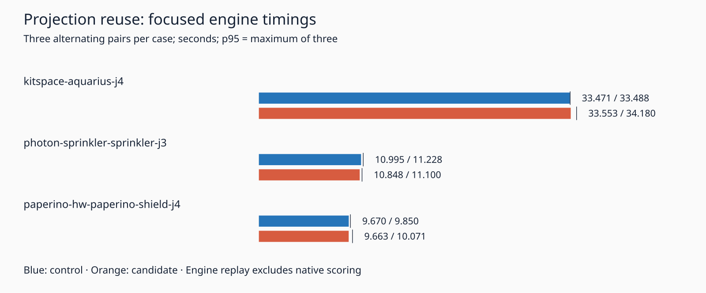

# Point-to-segment projection reuse experiment

This package measures an isolated candidate for `dist2PtSeg`. The original computes a projection from each endpoint and later computes the segment's squared length for an interior point. The candidate computes the first projection and squared length once, testing the second endpoint with `projection >= length2`. The degeneracy check, cross product and squared-distance division stay in the same order. Only the archived candidate's `src/geom/distance.ts` changes. No production router code, settings, rules, checker, recovery setting or consumer pin changes in this topic.

The historical control source and three complete input/settings/session captures are preserved in `reference`. `prepare.py` reconstructs both variants and checks all 1,490 tracked source/spec/package/config files against `audit.json`. These are historical recovery-branch sources, with recovery disabled for every replay; they are not the production sources at this topic's main base. The existing archive includes its original specification fixtures and licensing notices.

The differential probe passes 2,633,274 `Object.is` squared-distance comparisons: a small exhaustive point grid, deterministic random points, reversed and degenerate segments, both endpoint equalities, and combinations of coordinates at the documented ±2^25 limits. This is finite integer-coordinate coverage, not a proof for arbitrary floats or nonfinite inputs. Candidate typecheck and 17 existing geometry/invariance tests pass (253,599 assertions). `targeted-tests.tar.xz` preserves those unchanged tests. Full candidate tests are not claimed. The unchanged recovery checkout passed typecheck, layer checks and 914 tests; this topic's unchanged main-based checkout passed typecheck, layer checks and 859 tests.

An initial timing pair accidentally overlapped the unchanged full test suite. Both attempts completed; their outputs and process record remain in `initial-overlap.tar.xz` and `initial-overlap.json`. That pair is excluded from the valid timing comparison. The runner was stopped after launching the candidate, which completed before the process audit found no remaining routing jobs. A subsequent candidate static-check command initially included an incomplete copy of unrelated tests and failed on their missing support modules. Restricting the scratch test directory to the three intended geometry/invariance files restored typecheck. Both logs are retained. Neither setup incident alters candidate implementation or the valid timing schedule.

The valid batch uses the same machine, cores 12–19, nice 10, seed 1, inputs and effective settings for three sequential alternating control/candidate pairs per case. Each attempt has a 180-second limit and five-second kill grace. No other owned heavy jobs run during that batch. Other host load remains uncontrolled. Timings cover direct engine replay, including engine checks and report generation; they exclude native conversion/refill/checking. p95 is nearest rank, the maximum of only three observations.

The archive verifier checks the complete schedule, all 18 sessions byte for byte against retained independent controls, complete settings/results/reports after removing only `report.wallClockMs`, and every timing and recomputed summary. Its corruption tests run under normal and optimized Python. Engine residuals and represented violations are not native benchmark scores. Existing native thermal findings remain unresolved. No full native 26×3, dense input, ladder or full slow-acceptance result is inferred from these focused replays.

Reproduce with an unused scratch path from repository root:

```bash
p=docs/pr-assets/agent-fab-router-perf-projection-reuse
w=/home/hyper/bench/agents/codex-fabpcb-perf/scratch/projection-reuse-repro
python3 "$p/prepare.py" "$w"
python3 "$p/run.py" "$w"
python3 "$p/collect.py" "$w"
python3 "$p/plot.py"
```

The last two commands deliberately regenerate this package's timing summary/archive and chart; use a disposable checkout. Verify the retained evidence without routing:

```bash
p=docs/pr-assets/agent-fab-router-perf-projection-reuse
PYTHONDONTWRITEBYTECODE=1 python3 "$p/verify.py"
PYTHONDONTWRITEBYTECODE=1 python3 "$p/test_verify.py"
PYTHONDONTWRITEBYTECODE=1 python3 -O "$p/test_verify.py"
python3 "$p/check-candidate.py" /home/hyper/bench/agents/codex-fabpcb-perf/scratch/projection-candidate-check
```

`check-candidate.py` expects the repository's existing dependencies. It reconstructs a fresh candidate, extracts the retained focused tests, runs typecheck and those tests. Full native before/after measurements and unchanged-or-better completion/DRC/via/length results are required before any production adoption.

## Measured result: candidate not adopted

| Case                           | Control median / p95 seconds | Candidate median / p95 seconds | Median change |
| ------------------------------ | ---------------------------: | -----------------------------: | ------------: |
| kitspace-aquarius-j4           |        33.471323 / 33.488166 |          33.552856 / 34.179954 |        +0.24% |
| photon-sprinkler-sprinkler-j3  |        10.995455 / 11.227986 |          10.848180 / 11.100230 |        -1.34% |
| paperino-hw-paperino-shield-j4 |          9.669897 / 9.850162 |           9.662909 / 10.071443 |        -0.07% |

Sum of the nine valid durations per variant: 162.125379 → 162.999774 seconds (+0.54%). Aquarius median/p95 and shield p95 regress; sprinkler improves. Shared-host noise is uncontrolled. This mixed result does not establish a speed gain or attribute costs to arithmetic, allocation, JIT or any other cause. The candidate is rejected for production adoption at this gate. No full native sweep follows the focused rejection.


