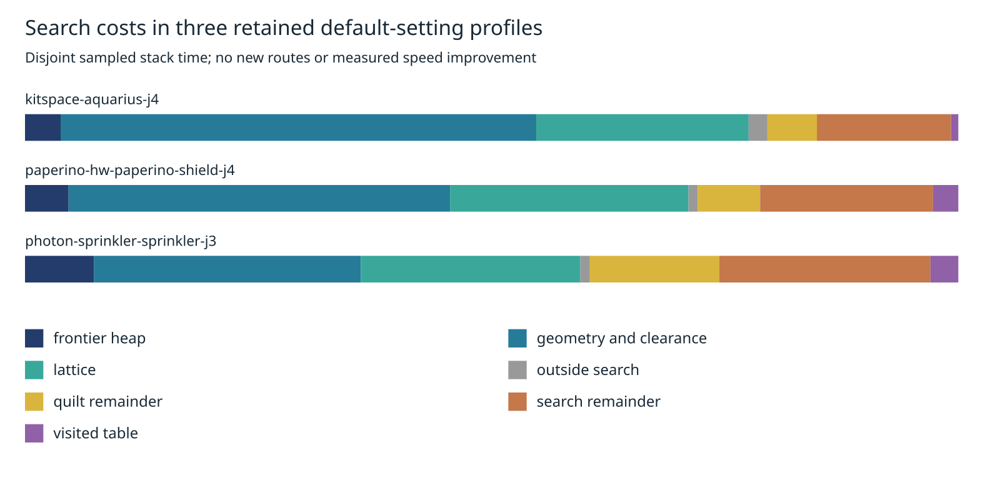

# Search bookkeeping in retained slow-case profiles

This diagnostic reuses three complete default-setting CPU profiles captured in cycle87 on hyper-ms-lin, cores 12–19. It runs no new routing and changes no engine behavior, settings, scoring, or consumer pin. The original source audit is retained in source-audit.json. Original captures and output-parity validation are available at commit c90b8512 under docs/pr-assets/agent-fab-router-perf-local-rescue/default-slow-profile. Profile SHA-256 values are recorded in summary.json.

Each sampled leaf is attributed to its nearest recognized subsystem under the nearest aStar/aStarLayered ancestor. Unrecognized descendants belong to that subsystem. Samples outside search remain explicit. Source-qualified names avoid confusing unrelated functions. Geometry below lattice belongs to geometry; lattice below clearance belongs to lattice. The resulting groups are disjoint; their weights and per-search-context weights each conserve the entire profile weight. These are sampled stack observations with JIT inlining effects, not exclusive function elapsed time, operation counts, allocation costs, or predicted speedups. The search and quilt remainder groups include inlined/unrecognized work.

| Case         | Geometry + clearance | Lattice | Quilt remainder | Search remainder |  Heap | Visited table | Outside search |
| ------------ | -------------------: | ------: | --------------: | ---------------: | ----: | ------------: | -------------: |
| Aquarius J4  |               50.96% |  22.75% |           5.30% |           14.36% | 3.82% |         0.79% |          2.01% |
| Shield J4    |               40.88% |  25.54% |           6.68% |           18.52% | 4.67% |         2.71% |          1.00% |
| Sprinkler J3 |               28.61% |  23.51% |          13.88% |           22.62% | 7.38% |         2.98% |          1.02% |

Geometry and lattice together account for 52.12–73.72% of sampled time. This favors investigating the geometry-query context before another visited-table experiment. It does not justify reviving rejected caches, wrappers, heap changes, or table-capacity changes. A next bounded diagnostic should measure repeated sweep geometry and the cost of exact rim checks using existing ownership/invalidation rules before implementing another cache. Historical profiles alone cannot establish current speed or safe cache hit rates.

Historical measurements below are context only: one unprofiled and one profiled replay per case, same machine/settings/source, different instrumentation. They are **not a candidate before/after comparison**. No new median, p95, completion, opens, native DRC, via or length measurement exists in this cycle.

| Case         | Historical unprofiled route seconds (1) | Historical profiled route seconds (1) | New candidate measurement |
| ------------ | --------------------------------------: | ------------------------------------: | ------------------------- |
| Aquarius J4  |                               42.273994 |                             37.065765 | Not run                   |
| Shield J4    |                               11.859914 |                             11.268750 | Not run                   |
| Sprinkler J3 |                               13.131539 |                             12.793578 | Not run                   |

Native thermal errors remain unresolved in the earlier experiment. Local recovery remains opt-in on its separate branch. No speed or DRC improvement is claimed here; full 26×3 native comparisons, dense6, ladder and slow acceptance remain required before adopting an engine improvement.

Reproduce from the repository root:

```bash
asset=docs/pr-assets/agent-fab-router-perf-search-profile
python3 -B "$asset/analyze.py" /tmp/search-partition.json
cmp /tmp/search-partition.json "$asset/summary.json"
python3 -B "$asset/test_analyze.py"
python3 -B -O "$asset/test_analyze.py"
python3 -B "$asset/plot.py"
rsvg-convert -w 1600 "$asset/profile.svg" -o /tmp/search-partition.png
cmp /tmp/search-partition.png "$asset/profile.png"
taskset -c 12-19 nice -n 10 timeout --kill-after=10 1800 bash -c 'bun run typecheck && bun run check:layers && bun run test'
```

Synthetic tests cover nearest-subsystem attribution, nested-search contexts, source qualification, conservation, duplicate nodes, unknown children/samples, cycles, duration count mismatch, negative and nonfinite durations. Tests run with normal and optimized Python. The PNG was visually inspected. No benchmark completed, so no results-history row is added.



Validation on this diagnostic branch: typecheck PASS; 65 layer files / zero violations; 859 tests / zero failures / 398454 assertions (202.10 seconds). Full output is retained in checks.log.gz.
