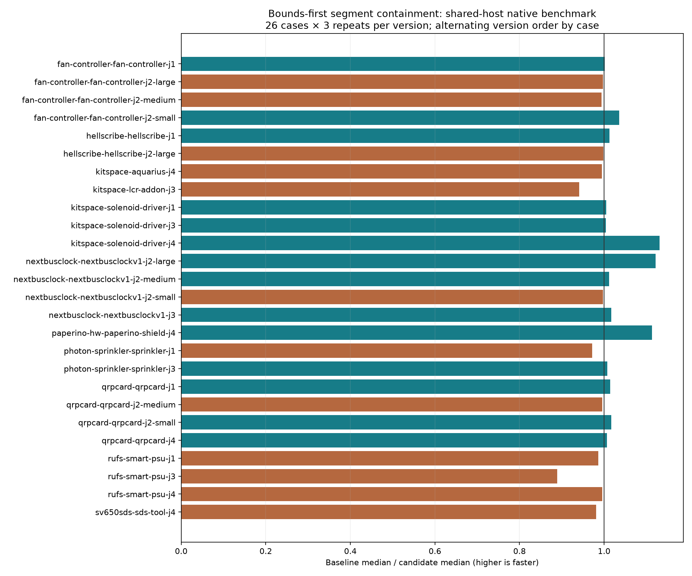

# Bounds-first segment experiment

The bounds-first `onSeg` experiment is **rejected**: the sampled-call replay regresses 56.2% and the fixed-pass L2 ladder median regresses 5.3%, while full native total route time is nearly unchanged. It checks the closed segment box before computing the cross product, preserving exact integer containment. The final production and test trees are restored to baseline `69cf598`; this PR retains reproducible diagnostic tools and measurements, not a routing speedup.

Baseline `69cf598` versus rejected experiment `caaacc3`, same Linux host `hyper-ms-lin`, cores 12–19, nice 10. Own tests, tracing, replay, full native runs, ladder runs and profiles execute sequentially. Shared-host timing variation remains; measurements do not establish a universal causal performance change. Frozen benchmark inputs, settings, rules, native checker and runtime are unchanged.

| Measurement | Baseline | Rejected candidate | Repeats/version |
|---|---:|---:|---:|
| Native sum of 26 case medians, s | 123.463 | 122.025 | 3/case |
| Native total route time, s | 372.133 | 372.261 | 78 attempts |
| Native passing attempts | 39/78 | 39/78 | 3/case |
| Native cases passing 3/3 | 13/26 | 13/26 | 3/case |
| Native opens / new errors | 120 / 27 | 120 / 27 | 3/case |
| Fixed 2-pass l1.dsn median, s | 0.145354 | 0.129932 | 3 |
| Fixed 2-pass l2.dsn median, s | 19.027905 | 20.037668 | 3 |
| Sample replay median, s / 10 million calls | 0.043876 | 0.068522 | 6 + excluded warmup |
| Profiled Paperino median, s | 12.809747 | 13.590803 | 3 |

All 78 paired native SES hashes, pass/fail, opens, native error counts/types, fidelity checks, vias and lengths match. The analyzer also verifies source/configuration hashes and chronological schedule. 14 case medians are faster and 12 slower. Existing native failures remain: this is not a DRC-clean suite or a five-router ranking. Per-case p95 uses nearest rank (the maximum of three repeats); timing includes failed attempts for performance diagnosis rather than scoring.

All 12 fixed-pass ladder sessions match by input, with no timeout. L1 is complete; L2 retains 29 incompletes and zero added router violations. These router counters are not native DRC. Frozen synthetic ladder inputs and hashes are retained. Newer ladder revisions and L3 are outside this paired experiment.

The diagnostic trace records 973,406,601 `onSeg` calls, 973,396,776 outside the closed segment box. It completes without timeout and its session matches all six profiled baseline/candidate sessions. The deterministic bounded reservoir retains 10,000 calls, all outside the box and all returning false. Replay times the original and candidate inline predicates over this captured corpus, not full routing or hit-heavy geometry; it reports a 56.2% regression. Differential candidate tests separately cover endpoints, reversed/degenerate segments and large integer coordinates (100,081 assertions). The reservoir uses a fixed 32-bit generator with modulo selection; it is a diagnostic sample, not a statistical coverage guarantee. Instrumented route time is not a baseline speed measurement.

CPU profiles contain 37,783 → 37,150 total samples. Named `onSeg` self samples: 1,555 → 0; `pointInRing`: 979 → 9,243. Attribution moves with JIT inlining, so function counts do not establish that work disappeared. Full reports, top self samples and raw-profile hashes are retained in `profile-summary.json`; raw profiles stay in local scratch.

No fresh slow acceptance claim is made: the candidate is rejected at the performance gate and is not adopted. The restored baseline retains its previously documented slow acceptance failures. Candidate validation passed typecheck, layers (65 files, zero violations), and 860 unit tests / 498,535 assertions in 222.08 s. Final restored-source validation results are recorded below.

Final restored-source validation passes typecheck, layers (65 files, zero violations), all 859 baseline tests / 398,454 assertions in 218.78 s, and strict TypeScript checks for replay, tracing, ladder and profile tools. A deliberate mixed-source control record is rejected by the analyzer; the complete unmodified run passes. The ladder overwrite guard rejects an existing output without changing its hash. The retained instrumentation generator recreates the exact measured instrumented predicate. The rejected patch passes reverse-apply checking on the candidate and forward-apply checking on restored source. Final `src`, `spec`, `tools` and `test` trees exactly match `69cf598`.



## Reproduce

```bash
# From this router checkout; use fresh worktree and output directories.
git worktree add -b agent/fab-router-perf-segment-base /home/hyper/bench/agents/codex-fabpcb-perf/scratch/segment-base 69cf598
git worktree add -b agent/fab-router-perf-segment-reproduce /home/hyper/bench/agents/codex-fabpcb-perf/scratch/segment-reproduce caaacc3
bun install --cwd /home/hyper/bench/agents/codex-fabpcb-perf/scratch/segment-base
bun install --cwd /home/hyper/bench/agents/codex-fabpcb-perf/scratch/segment-reproduce
taskset -c 12-19 nice -n 10 timeout 900 bash -c 'cd /home/hyper/bench/agents/codex-fabpcb-perf/scratch/segment-reproduce && bun run typecheck && bun run check:layers && bun run test'
taskset -c 12-19 nice -n 10 timeout 10800 python3 docs/pr-assets/agent-fab-router-perf-segment/paired-native.py --benchmark-checkout /home/hyper/bench/wt/fp-perf --baseline-source /home/hyper/bench/agents/codex-fabpcb-perf/scratch/segment-base --candidate-source /home/hyper/bench/agents/codex-fabpcb-perf/scratch/segment-reproduce --out /home/hyper/bench/agents/codex-fabpcb-perf/scratch/segment-native
python3 docs/pr-assets/agent-fab-router-perf-segment/summarize-paired.py /home/hyper/bench/agents/codex-fabpcb-perf/scratch/segment-native --out /home/hyper/bench/agents/codex-fabpcb-perf/scratch/segment-summary --label native
taskset -c 12-19 nice -n 10 timeout 2400 bun docs/pr-assets/agent-fab-router-perf-segment/ladder-route.ts /home/hyper/bench/agents/codex-fabpcb-perf/scratch/segment-base /home/hyper/bench/agents/codex-fabpcb-perf/scratch/segment-reproduce docs/pr-assets/agent-fab-router-perf-segment/ladder-inputs /home/hyper/bench/agents/codex-fabpcb-perf/scratch/segment-ladder.json
taskset -c 12-19 nice -n 10 timeout 600 bun docs/pr-assets/agent-fab-router-perf-segment/segment-replay.ts docs/pr-assets/agent-fab-router-perf-segment/segment-corpus.json /home/hyper/bench/agents/codex-fabpcb-perf/scratch/segment-replay.json
# Requires matplotlib in the selected Python environment:
taskset -c 12-19 nice -n 10 /home/hyper/bench/agents/codex-fabpcb-perf/scratch/plot-venv/bin/python docs/pr-assets/agent-fab-router-perf-segment/plot.py --measurements /home/hyper/bench/agents/codex-fabpcb-perf/scratch/segment-summary/native-measurements.json --output reproduced-native.png
# Profile both source versions sequentially with the freshly exported native input:
work=(/home/hyper/bench/agents/codex-fabpcb-perf/scratch/segment-native/before/paperino-hw-paperino-shield-j4/runs/*/fab-router/work)
mkdir -p /home/hyper/bench/agents/codex-fabpcb-perf/scratch/segment-profiles
for source in segment-base segment-reproduce; do
  taskset -c 12-19 nice -n 10 timeout 600 bun --cpu-prof --cpu-prof-dir /home/hyper/bench/agents/codex-fabpcb-perf/scratch/segment-profiles docs/pr-assets/agent-fab-router-perf-segment/profile-route.ts "/home/hyper/bench/agents/codex-fabpcb-perf/scratch/$source" "${work[0]}" 3
done
# Optional: regenerate the diagnostic corpus from an instrumented baseline archive.
python3 docs/pr-assets/agent-fab-router-perf-segment/instrument-segments.py /home/hyper/bench/wt/fr-perf 69cf598 /home/hyper/bench/agents/codex-fabpcb-perf/scratch/segment-instrumented
taskset -c 12-19 nice -n 10 timeout 600 bun docs/pr-assets/agent-fab-router-perf-segment/trace-route.ts /home/hyper/bench/agents/codex-fabpcb-perf/scratch/segment-instrumented "${work[0]}" /home/hyper/bench/agents/codex-fabpcb-perf/scratch/segment-corpus.json
```

`rejected-candidate.patch` retains the exact experimental production and test diff. The trace instrumentation preserves original predicate results; setup validates the expected source and refuses to replace an existing directory. Replay and trace output paths must be new. The first local trace setup failed because its archive lacked `spec`; it was corrected before any measurements, and the retained setup includes both `src` and `spec`.

## All native cases

All 78 paired SES hashes and quality outcomes match.

| Case | Before median / p95 s | After median / p95 s | Speedup | Passed (both) | Opens / errors (both) |
|---|---:|---:|---:|---:|---:|
| fan-controller-fan-controller-j1 | 3.514 / 3.518 | 3.510 / 3.531 | 1.00× | 0/3 | 15 / 0 |
| fan-controller-fan-controller-j2-large | 0.846 / 0.847 | 0.848 / 0.901 | 1.00× | 3/3 | 0 / 0 |
| fan-controller-fan-controller-j2-medium | 0.724 / 0.729 | 0.728 / 0.730 | 0.99× | 3/3 | 0 / 0 |
| fan-controller-fan-controller-j2-small | 3.184 / 3.576 | 3.074 / 3.155 | 1.04× | 0/3 | 3 / 0 |
| hellscribe-hellscribe-j1 | 2.174 / 2.273 | 2.147 / 2.278 | 1.01× | 0/3 | 9 / 0 |
| hellscribe-hellscribe-j2-large | 0.990 / 0.992 | 0.992 / 1.019 | 1.00× | 0/3 | 3 / 0 |
| kitspace-aquarius-j4 | 47.846 / 48.662 | 48.078 / 54.929 | 1.00× | 0/3 | 45 / 18 |
| kitspace-lcr-addon-j3 | 2.152 / 2.392 | 2.286 / 2.534 | 0.94× | 3/3 | 0 / 0 |
| kitspace-solenoid-driver-j1 | 0.736 / 0.763 | 0.733 / 0.852 | 1.00× | 3/3 | 0 / 0 |
| kitspace-solenoid-driver-j3 | 0.734 / 0.742 | 0.731 / 0.732 | 1.00× | 3/3 | 0 / 0 |
| kitspace-solenoid-driver-j4 | 0.879 / 0.890 | 0.777 / 0.891 | 1.13× | 3/3 | 0 / 0 |
| nextbusclock-nextbusclockv1-j2-large | 3.479 / 3.497 | 3.101 / 3.196 | 1.12× | 3/3 | 0 / 0 |
| nextbusclock-nextbusclockv1-j2-medium | 0.989 / 1.016 | 0.977 / 0.985 | 1.01× | 3/3 | 0 / 0 |
| nextbusclock-nextbusclockv1-j2-small | 0.719 / 0.843 | 0.721 / 0.729 | 1.00× | 3/3 | 0 / 0 |
| nextbusclock-nextbusclockv1-j3 | 7.957 / 7.991 | 7.827 / 7.915 | 1.02× | 0/3 | 9 / 0 |
| paperino-hw-paperino-shield-j4 | 14.272 / 14.485 | 12.819 / 12.844 | 1.11× | 0/3 | 18 / 0 |
| photon-sprinkler-sprinkler-j1 | 10.167 / 10.349 | 10.459 / 10.821 | 0.97× | 0/3 | 6 / 0 |
| photon-sprinkler-sprinkler-j3 | 13.652 / 14.864 | 13.549 / 13.680 | 1.01× | 0/3 | 6 / 0 |
| qrpcard-qrpcard-j1 | 1.356 / 1.358 | 1.337 / 1.351 | 1.01× | 3/3 | 0 / 0 |
| qrpcard-qrpcard-j2-medium | 0.875 / 0.905 | 0.879 / 0.881 | 1.00× | 3/3 | 0 / 0 |
| qrpcard-qrpcard-j2-small | 0.747 / 0.760 | 0.734 / 0.745 | 1.02× | 0/3 | 0 / 6 |
| qrpcard-qrpcard-j4 | 0.998 / 1.305 | 0.991 / 1.014 | 1.01× | 0/3 | 0 / 3 |
| rufs-smart-psu-j1 | 0.733 / 0.744 | 0.743 / 0.756 | 0.99× | 3/3 | 0 / 0 |
| rufs-smart-psu-j3 | 1.759 / 1.791 | 1.978 / 2.055 | 0.89× | 0/3 | 3 / 0 |
| rufs-smart-psu-j4 | 1.122 / 1.128 | 1.127 / 1.242 | 1.00× | 0/3 | 3 / 0 |
| sv650sds-sds-tool-j4 | 0.863 / 0.871 | 0.879 / 1.005 | 0.98× | 3/3 | 0 / 0 |

Sum of case medians: 123.463 → 122.025 seconds.
before: total 372.133s; 39/78 passed; 120 opens; 27 new native errors.
after: total 372.261s; 39/78 passed; 120 opens; 27 new native errors.
