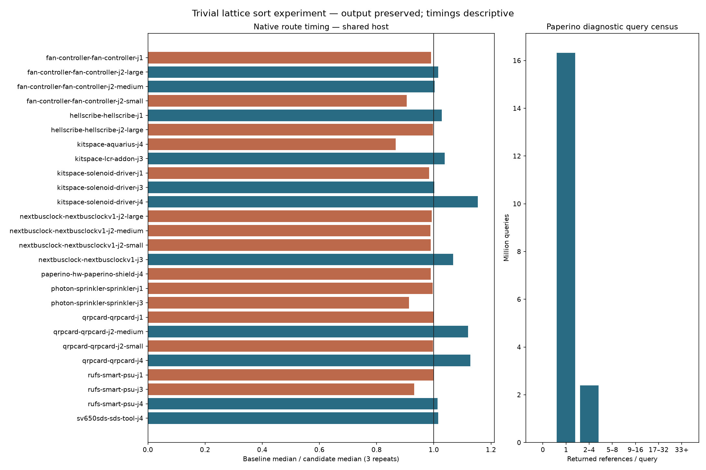

# Trivial lattice result sorting experiment — not adopted

The lattice sorts every query result. Candidate `c975b79` skips `out.sort` when the result has at most one reference, leaving all larger-result sorting and public query behavior unchanged. This isolates one collection hotspot from the pending routing fixes.

The candidate is **rejected**. Native Aquarius, native Paperino and CPU-profiled Paperino are adverse; the native sum of case medians increases. The small favorable L2 median does not establish a useful routing gain. Final `src`, `spec`, `tools` and `test` trees exactly match main `69cf598`. This PR retains the exact rejected patch, diagnostic tools, measurements and chart. No routing optimization is shipped and no causal slowdown or speedup is claimed.

All workloads use **hyper-ms-lin**, Bun 1.4.0, cores **12–19**, the same inputs/settings per workload and `taskset`/`nice -n 10` (effective nice 15). Own heavy measurements/tests run sequentially; light analysis/type checks overlap routing/tests. Other host workloads are uncontrolled. Timing differences are descriptive. Native p95 is the nearest-rank maximum of only three repeats, a limited tail estimate. Timings include failed attempts and are not official benchmark ranking scores.

| Workload | Repeats/version | Before median s | Candidate median s | Change |
|---|---:|---:|---:|---:|
| Native sum of 26 case medians | 3/case | 122.911862 | 130.577261 | +6.24% |
| Native Aquarius | 3 | 43.061252 | 49.710792 | +15.44% |
| Native Paperino | 3 | 16.151168 | 16.315988 | +1.02% |
| l1.dsn fixed two passes | 3 | 0.150408 | 0.159324 | +5.93% |
| l2.dsn fixed two passes | 3 | 21.440674 | 21.022134 | -1.95% |
| CPU-profiled Paperino | 3 separate processes | 16.747308 | 17.252962 | +3.02% |

Both versions have **39/78 passing native attempts**, **13/26 cases passing 3/3**, **120 opens**, and **27 new native errors relative to frozen input**. Those errors are existing baseline failures; the suite is not DRC-clean. All **78 paired SES hashes**, pass/open/error types, fidelity outcomes, vias and lengths match. The analyzer checks each captured source hash against the measured commit, constant runtime/checker/config/input identities, and sequential invocation chronology. All failed attempts are retained. Native total route time over 78 attempts/version is **371.318 → 390.687 seconds**.

All 12 fixed-pass ladder sessions match, with no timeout/abort. L1 completes; L2 retains 29 incomplete connections and zero added router violations. Ladder counters are **not native DRC**. The committed unsuffixed L1/L2 inputs match the board directory; newer revisions, L3 and BGA boards are outside this experiment. No fresh slow acceptance is claimed: the candidate was rejected at the performance gate before adoption; previously documented slow-suite failures remain.



The separate baseline Paperino census records **18,724,856 queries**: **16,325,319 singleton results** (87.19%), no empty results/missing sheets, **21,811,561 returned references**, **3,518,264 sort comparisons**, **62,888,235 bucket visits**, **6,655,871 duplicate bucket visits**, and **37,303,333 shelf visits**. The last histogram bin means 33 or more references. The instrumented route emits exactly the native/profiled SES with the same input/settings and no timeout/abort. Instrumentation time is diagnostic only and excluded from performance comparisons. These counters do not establish allocator/GC savings or explain the adverse timings.

Each CPU profile is a separate process with native Paperino settings and the same SES. Sample totals are **45,516 → 48,617**; `collect` self samples **6,187 → 6,265**, builtin `sort` **88 → 90**. Attribution and inlining move work between frames. Raw profiles remain in cycle15 scratch; `extra-summary.json` retains hashes, route reports, top self frames and line ticks. No measured heap/GC claim is made.

Candidate typecheck/layers and all **859 tests** pass (**398,454 assertions**, 216.07 seconds). Existing lattice property tests and route fingerprints remain unchanged. Final restored-source typecheck/layers and all **859 tests** pass (**398,454 assertions**, 237.71 seconds); the engine/test trees match main. This is not a fresh native rerun after restoration. Details are recorded in `validation.json`. No tests, expectations, frozen cases, checker or rules were weakened.

The census generator reproduces the exact measured instrumented source. Its overwrite guard preserves existing source. An analyzer mutant using the wrong candidate source commit is rejected before report output. Both measurement helpers pass strict TypeScript checks; Python sources parse and the reproduction shell passes `bash -n`. The rejected patch applies to restored main. Source/archive/generator/profile hashes are retained. The chart was visually inspected.

Reproduce from this branch, with the native private benchmark runtime staged and matplotlib available:

```bash
bash docs/pr-assets/agent-fab-router-perf-sort/reproduce.sh /home/hyper/bench/agents/codex-fabpcb-perf/scratch/sort-reproduce
```

`reproduce.sh` contains every exact command, including independent source checkouts, required candidate checks, full 26×3/version native run, fixed-pass ladder, six separate CPU-profile processes and census. It uses unused output directories. `paired-native.py` resumes only completed per-case invocations. Per-attempt measurements below include vias/length in `native-measurements.json`; all quality/geometry fields match.

All 78 paired SES hashes and quality outcomes match.

| Case | Before median / p95 s | After median / p95 s | Median ratio (before / after) | Passed (both) | Opens / errors (both) |
|---|---:|---:|---:|---:|---:|
| fan-controller-fan-controller-j1 | 3.525 / 3.535 | 3.559 / 3.714 | 0.99× | 0/3 | 15 / 0 |
| fan-controller-fan-controller-j2-large | 0.880 / 1.002 | 0.866 / 0.869 | 1.02× | 3/3 | 0 / 0 |
| fan-controller-fan-controller-j2-medium | 0.730 / 0.731 | 0.728 / 0.739 | 1.00× | 3/3 | 0 / 0 |
| fan-controller-fan-controller-j2-small | 2.983 / 3.118 | 3.296 / 3.322 | 0.91× | 0/3 | 3 / 0 |
| hellscribe-hellscribe-j1 | 2.044 / 2.401 | 1.987 / 2.036 | 1.03× | 0/3 | 9 / 0 |
| hellscribe-hellscribe-j2-large | 1.006 / 1.130 | 1.008 / 1.012 | 1.00× | 0/3 | 3 / 0 |
| kitspace-aquarius-j4 | 43.061 / 46.664 | 49.711 / 50.991 | 0.87× | 0/3 | 45 / 18 |
| kitspace-lcr-addon-j3 | 2.265 / 2.268 | 2.181 / 2.433 | 1.04× | 3/3 | 0 / 0 |
| kitspace-solenoid-driver-j1 | 0.712 / 0.725 | 0.724 / 0.839 | 0.98× | 3/3 | 0 / 0 |
| kitspace-solenoid-driver-j3 | 0.727 / 0.850 | 0.726 / 0.728 | 1.00× | 3/3 | 0 / 0 |
| kitspace-solenoid-driver-j4 | 0.973 / 0.979 | 0.843 / 0.844 | 1.15× | 3/3 | 0 / 0 |
| nextbusclock-nextbusclockv1-j2-large | 2.997 / 3.292 | 3.018 / 3.069 | 0.99× | 3/3 | 0 / 0 |
| nextbusclock-nextbusclockv1-j2-medium | 0.968 / 0.969 | 0.979 / 1.002 | 0.99× | 3/3 | 0 / 0 |
| nextbusclock-nextbusclockv1-j2-small | 0.721 / 0.722 | 0.729 / 0.980 | 0.99× | 3/3 | 0 / 0 |
| nextbusclock-nextbusclockv1-j3 | 8.268 / 8.727 | 7.746 / 8.134 | 1.07× | 0/3 | 9 / 0 |
| paperino-hw-paperino-shield-j4 | 16.151 / 16.277 | 16.316 / 16.933 | 0.99× | 0/3 | 18 / 0 |
| photon-sprinkler-sprinkler-j1 | 11.503 / 11.557 | 11.553 / 14.331 | 1.00× | 0/3 | 6 / 0 |
| photon-sprinkler-sprinkler-j3 | 14.297 / 14.597 | 15.650 / 16.300 | 0.91× | 0/3 | 6 / 0 |
| qrpcard-qrpcard-j1 | 1.375 / 1.519 | 1.378 / 1.512 | 1.00× | 3/3 | 0 / 0 |
| qrpcard-qrpcard-j2-medium | 0.984 / 0.990 | 0.878 / 0.980 | 1.12× | 3/3 | 0 / 0 |
| qrpcard-qrpcard-j2-small | 0.729 / 0.740 | 0.731 / 0.862 | 1.00× | 0/3 | 0 / 6 |
| qrpcard-qrpcard-j4 | 1.267 / 1.270 | 1.123 / 1.254 | 1.13× | 0/3 | 0 / 3 |
| rufs-smart-psu-j1 | 0.865 / 0.890 | 0.865 / 0.882 | 1.00× | 3/3 | 0 / 0 |
| rufs-smart-psu-j3 | 1.766 / 1.929 | 1.896 / 2.035 | 0.93× | 0/3 | 3 / 0 |
| rufs-smart-psu-j4 | 1.247 / 1.248 | 1.232 / 1.239 | 1.01× | 0/3 | 3 / 0 |
| sv650sds-sds-tool-j4 | 0.869 / 0.870 | 0.856 / 0.899 | 1.02× | 3/3 | 0 / 0 |

Sum of case medians: 122.912 → 130.577 seconds.
before: total 371.318s; 39/78 passed; 120 opens; 27 new native errors.
after: total 390.687s; 39/78 passed; 120 opens; 27 new native errors.
