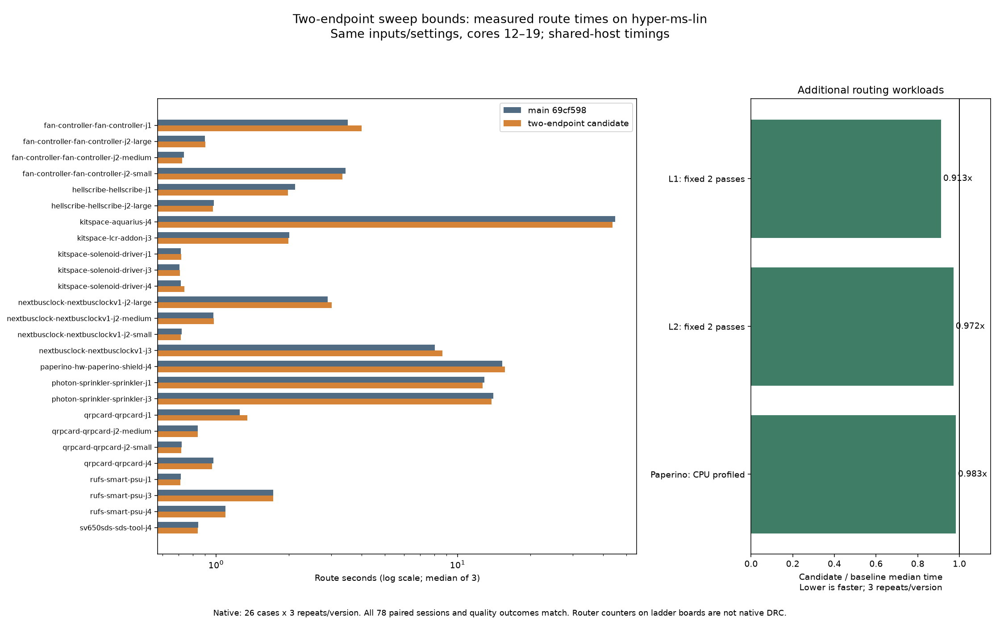

# Two-endpoint sweep bounds experiment — not adopted

`sweepClear` constructs a two-element point array and calls the general `dop8OfPts` loop on every query. Candidate `f45fb95` evaluates the two endpoints directly in a new `dop8OfSeg` helper, preserving first-endpoint ties and outward expansion rounding. This tests one hotspot independently of the other performance branches.

The full native sum of case medians is effectively unchanged, while native Paperino is 2.5% higher. Ladder and CPU-profile medians are lower. These mixed, small routing differences on a shared host do not establish a useful native-suite speedup, so the candidate is **not adopted**. Final `src`, `spec`, `tools` and `test` trees exactly match main `69cf598`. This PR retains the exact candidate/test patch, measurements, analysis tools and chart. No shipped speedup is claimed.

All measurements use **hyper-ms-lin**, Bun 1.4.0, cores **12–19**, and the same inputs/settings/checker/runtime per workload. Own heavy workloads ran sequentially under `taskset` and `nice -n 10` (effective nice 15). Light reporting/type checks overlap routing. Other host workloads remain uncontrolled; timing differences are descriptive, not causal estimates.

| Workload | Repeats/version | Before median s | Candidate median s | Change |
|---|---:|---:|---:|---:|
| Native sum of 26 case medians | 3/case | 123.674287 | 123.579785 | -0.08% |
| Native Paperino | 3 | 15.321675 | 15.712316 | +2.55% |
| l1.dsn fixed two passes | 3 | 0.152070 | 0.138765 | -8.75% |
| l2.dsn fixed two passes | 3 | 21.199104 | 20.610761 | -2.78% |
| CPU-profiled Paperino | 3 separate processes | 15.934511 | 15.669275 | -1.66% |

Total native route time across 78 attempts/version: **370.530 → 367.302 seconds**. Both versions pass **39/78 attempts**, with **13/26 cases passing 3/3**, **120 opens**, and **27 new native errors relative to the frozen input**. Those errors are existing baseline failures; this is not a DRC-clean suite. All 78 paired SES hashes, pass/open/error types/fidelity outcomes, vias and route lengths match. The native analyzer verifies source hashes against the measured commits, constant input/config/runtime identity and invocation chronology. Every failed attempt is retained.

All 12 ladder sessions match, with no timeout/abort. L1 completes; L2 retains 29 incomplete connections and zero added router violations. These are router counters, **not native DRC**. The committed unsuffixed L1/L2 boards match the board-agent directory; newer ladder revisions, L3 and BGA inputs are outside this experiment. No fresh slow acceptance was run: this candidate was rejected at the performance gate before adoption. Prior slow-suite failures remain unresolved; no candidate slow-acceptance pass is claimed.



Each of the six CPU-profiled processes uses native Paperino settings and emits the same SES as the native runs, with no timeout/abort. CPU sample totals are 42,927 → 43,610. Bounds self samples change from `dop8OfPts` 1,632 to `dop8OfPts` 65 plus `dop8OfSeg` 915; `sweepClear` is 2,821 → 2,690. Attribution and inlining can move samples between frames. This is not a measured heap-allocation or GC improvement.

Line-position ticks highlight unchanged work for future investigation: `onboard.ts:57` has 7,190 → 6,145 ticks; `grid.ts:283` has 2,321 → 1,899 and `grid.ts:289` 1,656 → 1,896. These are profiler attribution counts, not exact operation counts. `extra-summary.json` retains full reports, top self frames, top line ticks and raw CPU-profile hashes; raw profiles remain in cycle14 scratch.

The candidate differential test checks all eight slabs against the original helper over endpoint permutations, zero-length legs, signed-zero ties, coordinate limits and fractional expansion radii. Candidate typecheck/layers and all **860 tests** pass (**631,030 assertions**, 225.84 seconds). The test lives in the retained patch and candidate commit; it is removed with the unadopted helper from the final tree. No expectations, fingerprints, checker or DRC rules were weakened.

Final restored-source typecheck/layers and all **859 tests** pass (**398,454 assertions**, 229.68 seconds). The final engine and test trees exactly match the baseline; this is not a fresh native rerun of the restored tree.

The bounds-identity mutant is rejected before report output; the rejected patch applies cleanly to restored main. Both analysis helpers pass syntax checks; both TypeScript measurement helpers pass strict checking. See `source-provenance.json`, `execution.json` and `validation.json`. The shared results log has 52 fresh native invocation rows, four ladder rows and two profile rows; rerunning the logger adds zero duplicates.

To reproduce in unused directories, from this branch with the native private benchmark runtime already staged:

```bash
repo_assets="$PWD/docs/pr-assets/agent-fab-router-perf-sweep-bounds"
scratch=/home/hyper/bench/agents/codex-fabpcb-perf/scratch/sweep-bounds-reproduce
mkdir "$scratch"
assets="$scratch/assets"
mkdir "$assets"
cp "$repo_assets"/*.py "$repo_assets"/*.ts "$repo_assets"/*.dsn "$repo_assets"/source-provenance.json "$assets/"
baseline="$scratch/baseline"
candidate="$scratch/candidate"
git worktree add -b agent/fab-router-perf-sweep-bounds-repro-base "$baseline" 69cf598
git worktree add -b agent/fab-router-perf-sweep-bounds-repro-candidate "$candidate" f45fb95
bun install --cwd "$baseline" --frozen-lockfile
bun install --cwd "$candidate" --frozen-lockfile
(cd "$candidate" && taskset -c 12-19 nice -n 10 timeout 900 bash -c 'bun run typecheck && bun run check:layers && bun run test')
taskset -c 12-19 nice -n 10 timeout 10800 python3 "$assets/paired-native.py" --benchmark-checkout /home/hyper/bench/wt/fp-perf --baseline-source "$baseline" --candidate-source "$candidate" --out "$scratch/cycle14-paired"
python3 "$assets/summarize-paired.py" "$scratch/cycle14-paired" --out "$assets"
taskset -c 12-19 nice -n 10 timeout 1800 bun "$assets/ladder-route.ts" "$baseline" "$candidate" "$assets" "$assets/ladder.json"
work=("$scratch"/cycle14-paired/before/paperino-hw-paperino-shield-j4/runs/*/fab-router/work)
for pair in before:1 after:1 after:2 before:2 before:3 after:3; do
  version=${pair%:*}
  repeat=${pair#*:}
  source="$baseline"
  if [ "$version" = after ]; then source="$candidate"; fi
  name="cycle14-profile-$version-$repeat"
  mkdir "$scratch/$name"
  taskset -c 12-19 nice -n 10 timeout 600 bun --cpu-prof --cpu-prof-dir "$scratch/$name" "$assets/profile-route.ts" "$source" "${work[0]}" 1 > "$scratch/$name.log" 2>&1
done
python3 "$assets/summarize-extra.py" "$scratch"
# With matplotlib available:
python3 "$assets/plot.py"
```

The recorded source hashes are portable across checkout locations; no measurement helper reads credentials or starts services. The profile analyzer uses the source hashes, not the stored original paths. Preserve the `cycle14-` profile naming convention for the analyzer. Native p95 below is the nearest-rank maximum of three repeats, a limited tail estimate.

All 78 paired SES hashes and quality outcomes match.

| Case | Before median / p95 s | After median / p95 s | Median ratio (before / after) | Passed (both) | Opens / errors (both) |
|---|---:|---:|---:|---:|---:|
| fan-controller-fan-controller-j1 | 3.503 / 3.897 | 4.009 / 4.067 | 0.87× | 0/3 | 15 / 0 |
| fan-controller-fan-controller-j2-large | 0.900 / 1.052 | 0.902 / 1.020 | 1.00× | 3/3 | 0 / 0 |
| fan-controller-fan-controller-j2-medium | 0.735 / 0.853 | 0.723 / 0.724 | 1.02× | 3/3 | 0 / 0 |
| fan-controller-fan-controller-j2-small | 3.439 / 3.466 | 3.334 / 3.431 | 1.03× | 0/3 | 3 / 0 |
| hellscribe-hellscribe-j1 | 2.125 / 2.138 | 1.980 / 1.994 | 1.07× | 0/3 | 9 / 0 |
| hellscribe-hellscribe-j2-large | 0.977 / 0.982 | 0.968 / 0.978 | 1.01× | 0/3 | 3 / 0 |
| kitspace-aquarius-j4 | 44.833 / 46.586 | 43.777 / 44.083 | 1.02× | 0/3 | 45 / 18 |
| kitspace-lcr-addon-j3 | 2.004 / 2.156 | 1.987 / 2.100 | 1.01× | 3/3 | 0 / 0 |
| kitspace-solenoid-driver-j1 | 0.713 / 0.717 | 0.717 / 0.717 | 0.99× | 3/3 | 0 / 0 |
| kitspace-solenoid-driver-j3 | 0.705 / 0.711 | 0.709 / 0.717 | 0.99× | 3/3 | 0 / 0 |
| kitspace-solenoid-driver-j4 | 0.714 / 0.721 | 0.737 / 0.843 | 0.97× | 3/3 | 0 / 0 |
| nextbusclock-nextbusclockv1-j2-large | 2.895 / 3.016 | 3.005 / 3.191 | 0.96× | 3/3 | 0 / 0 |
| nextbusclock-nextbusclockv1-j2-medium | 0.974 / 0.977 | 0.976 / 0.976 | 1.00× | 3/3 | 0 / 0 |
| nextbusclock-nextbusclockv1-j2-small | 0.721 / 0.726 | 0.713 / 0.718 | 1.01× | 3/3 | 0 / 0 |
| nextbusclock-nextbusclockv1-j3 | 8.034 / 8.058 | 8.645 / 8.831 | 0.93× | 0/3 | 9 / 0 |
| paperino-hw-paperino-shield-j4 | 15.322 / 16.169 | 15.712 / 17.084 | 0.98× | 0/3 | 18 / 0 |
| photon-sprinkler-sprinkler-j1 | 12.886 / 12.892 | 12.659 / 13.267 | 1.02× | 0/3 | 6 / 0 |
| photon-sprinkler-sprinkler-j3 | 14.038 / 14.279 | 13.796 / 14.942 | 1.02× | 0/3 | 6 / 0 |
| qrpcard-qrpcard-j1 | 1.250 / 1.351 | 1.347 / 1.347 | 0.93× | 3/3 | 0 / 0 |
| qrpcard-qrpcard-j2-medium | 0.840 / 0.843 | 0.840 / 0.846 | 1.00× | 3/3 | 0 / 0 |
| qrpcard-qrpcard-j2-small | 0.721 / 0.724 | 0.716 / 0.738 | 1.01× | 0/3 | 0 / 6 |
| qrpcard-qrpcard-j4 | 0.972 / 1.015 | 0.963 / 0.963 | 1.01× | 0/3 | 0 / 3 |
| rufs-smart-psu-j1 | 0.715 / 0.717 | 0.711 / 0.712 | 1.01× | 3/3 | 0 / 0 |
| rufs-smart-psu-j3 | 1.722 / 1.730 | 1.722 / 1.724 | 1.00× | 0/3 | 3 / 0 |
| rufs-smart-psu-j4 | 1.093 / 1.098 | 1.092 / 1.102 | 1.00× | 0/3 | 3 / 0 |
| sv650sds-sds-tool-j4 | 0.844 / 0.849 | 0.840 / 0.842 | 1.01× | 3/3 | 0 / 0 |

Sum of case medians: 123.674 → 123.580 seconds.
before: total 370.530s; 39/78 passed; 120 opens; 27 new native errors.
after: total 367.302s; 39/78 passed; 120 opens; 27 new native errors.
