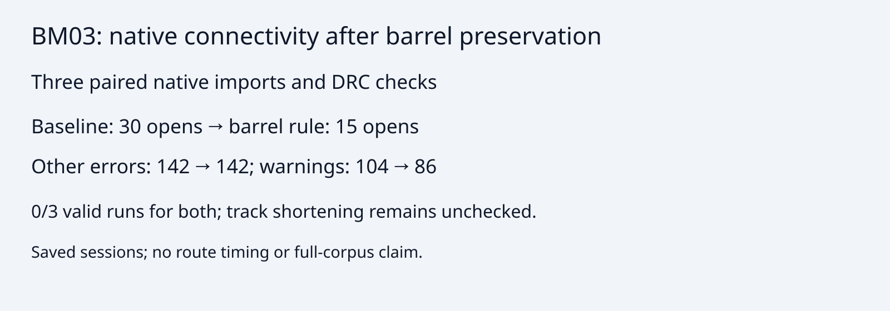

# Preserve surviving copper during barrel elimination

The optimizer previously accepted a barrel removal when its terminal-only incomplete
count did not increase. Removing a bridge to a track-only fragment could therefore
pass that test. Barrel trials now also require every surviving member of each
original component to remain together. Rejected trials use the existing journal
rewind. Track shortening retains its existing acceptance rule.

BM03 prepared native board, hyper-ms-lin, cores 6–11, three repeated sessions and
native checks per variant, stock KiCad 10.0.6:

| Metric | Baseline 69cf598 | Barrel preservation |
|---|---:|---:|
| Native opens, each repeat | 30 | 15 |
| Other native errors, each repeat | 142 | 142 |
| Warnings, each repeat | 104 | 86 |
| Tracks / barrels | 226 / 61 | 226 / 76 |
| Valid runs | 0/3 | 0/3 |

Candidate sessions from three fresh routes match the measured scratch experiment
byte for byte. Native checks rerun the same input board/session importer and rules.
This is a connectivity improvement on one board, not a valid route or full-suite
score. Extra connectivity computation adds work per barrel trial; no speed claim.
All 142 non-open native errors match by rule, message and sorted endpoint text
in each paired report; none added or removed (error-identity.json). Remaining opens and
track shortening need separate investigation.

Reproduction requires the prepared BM03 DSN and its paired native board, with
native project/custom-rule sidecars. Input hashes and session hashes are in
native.json; the inputs are not redistributed here. From the candidate repo root:

```sh
git worktree add /tmp/barrel-baseline 69cf598db98c136bff16bbe02bccdded95674b18
nice -n 10 taskset -c 6-11 timeout 360s bun docs/pr-assets/agent/preserve-barrel-components/measure.ts /tmp/barrel-baseline /path/to/unrouted.dsn /path/to/unrouted.kicad_pcb /tmp/barrel-before
nice -n 10 taskset -c 6-11 timeout 360s bun docs/pr-assets/agent/preserve-barrel-components/measure.ts . /path/to/unrouted.dsn /path/to/unrouted.kicad_pcb /tmp/barrel-after
bun run typecheck
bun run check:layers
nice -n 10 taskset -c 6-11 timeout 600s bun run test
```

The four focused regression tests cover a nonterminal bridge, ignored-net bridge,
redundant barrels with sequential decisions, an isolated barrel, and live-index /
journal restoration after rejection.



The Issue026 deterministic fingerprint intentionally changes: baseline/candidate
retain 34/40 barrels and 100/100 tracks, with 2/2 internal incompletes and 0/0
added internal violations. The exact hash assertion is retained and the candidate
counts are now asserted explicitly. issue026.json records this one-repeat audit;
it is an internal check, not a native validity measurement.

Validation: typecheck passes; layer checker reports 65 files / zero violations;
full suite passes 863 tests / 398480 assertions, including 403 fast acceptance cases.
